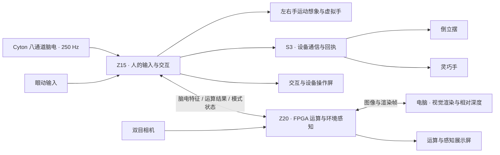

# 意动协同：Z15 与 Z20 多模态感知交互控制台

意动协同是一套把脑电感知、运动想象、眼动交互、FPGA 运算和外设控制组织到同一操作流程中的双 Zynq 系统。使用者通过眼动选择页面、表达需求和操作设备；系统实时接收八通道脑电，提供疲劳、情绪分析与左右手运动想象交互。Z15 负责人的输入与执行控制，Z20 负责辅助计算、相机采集与第二显示屏，电脑参与视觉渲染与相对深度计算。

作品面向 2026 年全国大学生嵌入式芯片与系统设计竞赛 FPGA 创新设计赛道，AMD 自主选题初级组。硬件为正点原子 Z15（XC7Z015 CLG485）与领航者 Z20（XC7Z020 CLG400），开发工具基线为 Vivado / Vitis HLS 2023.1。

## 作品能做什么

| 功能 | 使用流程与实现 |
| --- | --- |
| 实时脑电感知 | OpenBCI Cyton 以 250 Hz 采集固定八通道 EEG，经 USB 接收器进入 Z15。原采集服务完成解包、滤波、信号质量检查与分析，脑电页显示实时波形、特征和状态。 |
| 左右手运动想象 | 使用 F3/F4/C3/C4/T7/T8/O1/O2 八通道，按照提示完成左右手运动想象试次。现有固定八通道 RMS EEGNet 输出左右手候选，网页虚拟手按识别结果分步张开或闭合。 |
| 眼动操作 | 复用眼动标定、三区选择与停留确认，完成菜单导航、交流表达、多媒体选择及设备操作；页面呈现、确认和动作回执保持对应。 |
| 灵巧手与倒立摆 | Z15 经原 Wi-Fi / S3 执行链连接灵巧手与倒立摆。工程包含灵巧手开合、倒立摆方向与启停、蓝牙及射频通信、连接状态和执行反馈。 |
| 多任务 FPGA 运算 | Z20 部署可更换权重和输入维度的共享整数 MLP 核，承担疲劳、情绪、声音等三分类任务的辅助推理，并与软件整数参考逐项比对。 |
| 双屏感知展示 | Z15 保持交互与控制界面，Z20 显示流体、三维声谱、NPU 运算和空间感知页面。相机画面、推理结果、电脑渲染与交互事件通过双板协议关联。 |

运动想象当前对应提示试次识别与虚拟手交互，实物机构由已有眼控执行链操作。两条输入路径共用系统界面，各自保留清楚的结果与动作来源。

## 双 Zynq 如何协同



| 节点 | 具体职责 |
| --- | --- |
| Z15 ARM / Linux | 实时脑电接收、滤波与质量检查，运动想象推理，眼动菜单、设备会话和双板通信。 |
| Z15 PL | 相机与连续显示数据通路、像素处理、音频 FFT 等硬件模块，按对应固件版本使用。 |
| Z20 ARM / Linux | 相机与显示管理、特征与模型管理、PL 结果读取、双板消息及电脑画面接入。 |
| Z20 PL | 共享 INT8 MLP、双目视频数据通路、VDMA 帧状态观测与相关硬件接口。 |
| 电脑与外设控制器 | 电脑计算视觉效果与相对深度；S3、STM32 及手端控制器承接原设备通信和动作反馈。 |

## 实时 EEG 与运动想象

### 实时接收作为脑电页默认来源

本次更新将板端脑电展示入口接回已有 Cyton 实时采集服务。进入疲劳或情绪页即读取实时接收结果，切页保持同一数据流；接收器未就绪时显示等待，数据过期时清除旧波形和旧结论。Z20 的 NPU 脑电页改为显示接收到的特征运算结果，上游未就绪时显示等待。LEMON 录制数据保留为显式回放选项。

实时路径为：

```text
Cyton → USB 接收器 → Z15 原采集服务
                    ├─ 滤波 / 信号质量 / 疲劳与情绪分析
                    ├─ 已启用的运动想象试次分支 → /mi-cued → 虚拟手
                    └─ 只读状态与波形 → 疲劳 / 情绪展示页
```

[Cyton 接收](src/workspace/integrations/eeg_demo/brain_runtime/cyton_guardianloop.py)、[正式采集入口](src/workspace/integrations/eeg_demo/brain_runtime/guardianloop_acquisition.py)、[实时只读桥接](src/workspace/integrations/eeg_demo/runtime/eeg_demo_bridge.py)与[板端展示运行时](src/workspace/integrations/vision_demo/vision_demo/signal_runtime.py)构成这条实际代码路径。

### 把运动想象放进同一套交互工程

运动想象沿用工程已有的固定八通道实现。实时采集者把解码后的数据分送给 MI 分支，分支完成预热、8–30 Hz 带通、提示呈现对齐和有效窗口收集，再由 RMS EEGNet 给出左右手结果。当前试次在提示后偏移 0.5 秒取 2 秒、500 点窗口，计算运行在 Z15 ARM。

启用虚拟手交互后，左手结果对应张开一步，右手结果对应闭合一步，每步改变 20% 开合位置。每个试次对应一次结果和一次动作；界面同时显示数据质量、试次状态、模型结果与虚拟手位置。采集断流、序号间断、试次超时及页面离开都进入对应的撤销流程。

本次参考[脑电运动想象识别项目](https://github.com/Xsingh-Luo/fpga_eeg_rehab)梳理左右手想象、运动相关节律和提示试次的展示方式。本工程采用自身已有的八通道 RMS EEGNet 路线；参考项目采用 CSP / SVM，算法与实现分别保留各自来源。

MI 的[采集适配](src/workspace/integrations/eeg_demo/brain_runtime/mi_acquisition.py)、[试次与虚拟手逻辑](src/workspace/integrations/eeg_demo/brain_runtime/mi_cued.py)、[RMS 模型入口](src/workspace/integrations/eeg_demo/brain_runtime/mi_rms_live_virtual.py)和[网页桥接](src/workspace/integrations/eeg_demo/brain_runtime/mi_web_bridge.py)已包含在公开源码中。启用与接入步骤见[实时 EEG 与 MI 使用说明](report/eeg_live_mi.md)。

## FPGA 实现与工程工作

这套作品的工程工作覆盖算法、硬件数据通路、Linux 运行时、网络、交互与执行设备的共同运行。公开源码收录 RTL、HLS、PS Python、外设固件、构建脚本和测试，主要实现如下。

| 工作 | 实际内容与源码入口 |
| --- | --- |
| 共享整数推理核 | [HLS MLP](src/workspace/integrations/z20_compute/hardware/hls/mlp.cpp)实现 D→32 ReLU→3，输入维度 1–1024；使用 INT8 输入和权重、INT32 接口与溢出检查，处理移位、舍入和饱和。 |
| PS / PL 数值与内存配套 | [整数参考](src/workspace/integrations/z20_compute/z20_compute/npu.py)与[硬件适配](src/workspace/integrations/z20_compute/z20_compute/backend.py)覆盖权重与缓冲装载、缓存同步、MMIO、结果比对及超时后的内存所有权。 |
| 连续图像与视频通路 | 工程包含相机、VDMA、HDMI、像素滤镜和帧管理；[图像 HLS](src/workspace/integrations/vision_demo/hls/vision_core.cpp)包含边缘、运动差分、拖影及灰度处理等实现。 |
| 双目采集的帧一致性 | 自编写[VDMA 状态观测 RTL](src/workspace/integrations/z20_compute/hardware/rtl/z20_video_observer.sv)记录写入与完成状态、帧序号和硬件时间，供软件取得一致的相机快照。 |
| 定点音频分析 | [1024 点 FFT](src/workspace/integrations/vision_demo/hls/audio_fft.cpp)实现 Q15 输入、逐级缩放、自然频序和 513 个单边复数频点，配套波形、频谱与瀑布图。 |
| 实时脑电与 MI 分支 | 单一 Cyton 采集者服务多个分析消费者；MI 有有界队列、质量检查、提示试次、窗口管理、虚拟手与事件记录。 |
| 眼控与设备执行 | 眼动选择、页面阅读时间、换区确认、设备连接与动作回执共同管理灵巧手和倒立摆操作；相关代码位于 `integrations/eye_c3`、`integrations/pendulum_ble` 与 `multimodal/firmware`。 |
| 双板与电脑协同 | 特征、分类结果、菜单状态和 JPEG 图像分别传输；[画面协议](src/workspace/integrations/z20_compute/z20_compute/visual_wire.py)携带会话、模式代数和序号，接收端据此处理切页与过期消息。 |
| 发布与复用 | 配套源码路径恢复、文件摘要核对、安装事务、版本配对和回退工具；[PYNQ Skill](skill/README.md)整理固件核对、整数算例和会话恢复方法。 |

## 运行与源码导航

本公开版以 2026-11-01 参赛源码快照为基线，包含 4744 个原始源码、测试及配置条目，并记录本次实时展示入口修订。历史版本、当前入口和发布工具都保留在来源映射中。

| 目录 | 内容 |
| --- | --- |
| [src](src/README.md) | 规范化存储的工程源码；原目录与当前文件摘要见[来源清单](report/source_manifest.json)。 |
| [sim](sim/README.md) | 离线回归、实时入口测试与交付工具测试。 |
| [build](build/README.md) | 源码恢复、完整性检查与构建入口。 |
| [board](board/README.md) | 板型、硬件职责与接板条件。 |
| [data](data/README.md) | 可手算的整数参考正负例。 |
| [skill](skill/README.md) | 通用 PYNQ 验证工具、使用方法与示例。 |
| [report](report/README.md) | 运行说明、状态、来源、依赖和验证记录。 |

`report/source_manifest.json` 的 `runtime_path` 对应原工程路径，`package_path` 对应仓库存储位置。运行前恢复原路径与大小写：

```sh
python -X utf8 -B build/restore_workspace.py --output C:/work/intent_action_runtime
```

恢复后的主要入口：

- `integrations/eeg_demo/brain_runtime`：Cyton 接收、脑电分析和运动想象。
- `integrations/eeg_demo/runtime`、`integrations/eye_c3`：实时状态、眼动菜单与设备交互。
- `integrations/vision_demo`：Z15 图像流、脑电页、音频与显示硬件。
- `integrations/z20_compute`：共享 MLP、相机、四模式展示和双板协议。
- `integrations/pendulum_ble`、`multimodal/firmware`：外设通信与嵌入式固件。

## 在普通电脑验证

使用 Python 3.10 或更新版本，在仓库根目录执行：

```sh
python -m pip install numpy scipy pillow
python -X utf8 -B build/verify_package.py
python -X utf8 -B -m unittest discover -s sim -p "test_*.py" -v
python -X utf8 -B -m unittest discover -s skill/tests -v
python -X utf8 -B sim/run_checks.py --workspace C:/work/intent_action_runtime --output C:/work/intent_action_checks
```

最小检查集包含原有 33 项及本次新增的 8 项实时入口测试，共 41 项，覆盖整数运算、板型识别、缓冲所有权、会话过期、路径恢复、实时接收展示与手动来源选择。本次扩展回归共通过 160 项，覆盖 MI 试次、虚拟手、实时桥接、显示生命周期及双板协议。板端依赖、模型与固件准备步骤见[复现说明](report/reproduction.md)和[外部输入清单](report/external_inputs.json)。

工程已有板端运行和机构分项动作记录。本次更新的默认实时展示入口已完成软件回归；当前 MI 使用实验模型，佩戴识别效果按实际试次记录。各版本状态与后续实板验收项集中见[当前状态](report/current_status.md)，本次检查见[实时 EEG 与 MI 使用说明](report/eeg_live_mi.md)。

源码、模型和数据沿用各自版权声明，来源与许可见[第三方说明](report/third_party.md)。
