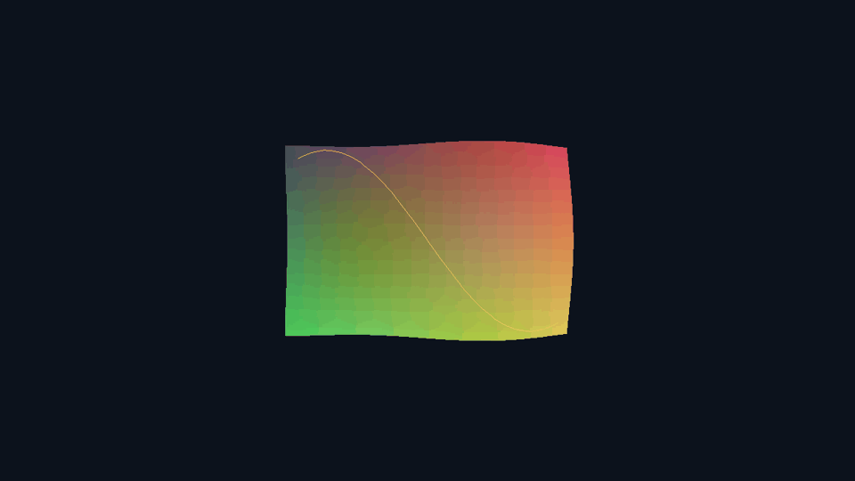
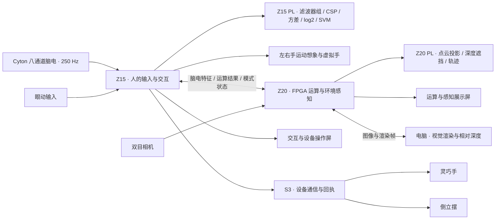

# 意动协同：Z15 与 Z20 多模态感知交互控制台

意动协同把实时脑电、左右手运动想象、眼动交互与三维环境感知组织成一套双 Zynq 多模态交互系统。Z15 的可编程逻辑完成“滤波器组 → CSP → 窗口方差 → 对数特征 → SVM”整条脑电识别路径；Z20 的可编程逻辑接管点云投影、深度遮挡与轨迹绘制。使用者通过原有眼控界面表达需求、操作灵巧手与倒立摆，双屏同步呈现人的状态和环境信息。

作品面向 2026 年全国大学生嵌入式芯片与系统设计竞赛 FPGA 创新设计赛道，AMD 自主选题初级组。硬件为正点原子 Z15（XC7Z015 CLG485）与领航者 Z20（XC7Z020 CLG400），开发工具基线为 Vivado / Vitis HLS 2023.1。

| 实时脑电输入 | Z15 PL 运动想象 | Z20 PL 空间绘制 |
| --- | --- | --- |
| 8 通道 · 250 Hz · 同一采集源 | 3 频带 · 6 个 CSP 分量 · 定点 SVM | 1280×720 · 65,536 点 · 1,024 轨迹点接口 |



上图来自本工程 HLS C++ 地图核：21,600 个彩色点和 80 个轨迹点生成三个 720p 观察方向，三帧与独立整数参考逐像素一致。配套 [RTL 联合仿真、资源与接口说明](report/pl_accel.md)记录脑电、点云及系统接入的完整实现。

## 作品能做什么

| 功能 | 使用流程与实现 |
| --- | --- |
| 实时脑电感知 | OpenBCI Cyton 以 250 Hz 采集固定八通道 EEG，经 USB 接收器进入 Z15。原采集服务完成解包、滤波、信号质量检查与分析，脑电页显示实时波形、特征和状态。 |
| 双路径运动想象 | 原 ARM RMS EEGNet 完成提示试次与虚拟手交互；Z15 PL 新增滤波器组、CSP、方差/对数和线性 SVM，连续发布左右手结果、特征、分数及模型身份。 |
| 眼动操作 | 复用眼动标定、三区选择与停留确认，完成菜单导航、交流表达、多媒体选择及设备操作；页面呈现、确认和动作回执保持对应。 |
| 灵巧手与倒立摆 | Z15 经原 Wi-Fi / S3 执行链连接灵巧手与倒立摆。工程包含灵巧手开合、倒立摆方向与启停、蓝牙及射频通信、连接状态和执行反馈。 |
| 多任务 FPGA 运算 | Z20 部署可更换权重和输入维度的共享整数 MLP 核，承担疲劳、情绪、声音等三分类任务的辅助推理，并与软件整数参考逐项比对。 |
| PL 地图与轨迹绘制 | 已有建模点云进入 Z20，硬件完成 Q16 变换、透视投影、裁剪、深度测试及轨迹光栅化，经原 HDMI 所有者显示；空间页可切换原有显示和 PL 绘制。 |
| 已知位姿建模复用 | 复用原双目点云与 `camera_to_world` 融合清单，将世界坐标点云和相机轨迹送入同一绘制接口；相对深度来源保留自身坐标单位。 |
| 双屏感知展示 | Z15 保持交互与控制界面，Z20 显示流体、三维声谱、NPU 运算和空间感知页面。相机画面、推理结果、电脑渲染与交互事件通过双板协议关联。 |

运动想象试次、PL 连续识别与眼控执行各自保留结果和动作来源。新增计算支路与原交互并行接入，原显示作为默认模式，空间页提供明确的后端切换。

## 双 Zynq 如何协同



| 节点 | 具体职责 |
| --- | --- |
| Z15 ARM / Linux | Cyton 接收、质量检查、原 EEGNet 试次与虚拟手，PL 参数及结果管理、眼动菜单、设备会话和双板通信。 |
| Z15 PL | 三频带多通道滤波、CSP、滑窗方差、定点 log2、SVM；整机继续包含相机、连续显示、像素处理和音频 FFT 模块。 |
| Z20 ARM / Linux | 相机与显示管理、特征与模型管理、PL 结果读取、双板消息及电脑画面接入。 |
| Z20 PL | 共享 INT8 MLP、双目视频、VDMA 帧状态观测，以及可切换的点云/地图/轨迹绘制核。 |
| 电脑与外设控制器 | 电脑计算视觉效果与相对深度；S3、STM32 及手端控制器承接原设备通信和动作反馈。 |

## 实时 EEG 与运动想象

### 实时接收作为脑电页默认来源

本次更新将板端脑电展示入口接回已有 Cyton 实时采集服务。进入疲劳或情绪页即读取实时接收结果，切页保持同一数据流；接收器未就绪时显示等待，数据过期时清除旧波形和旧结论。Z20 的 NPU 脑电页改为显示接收到的特征运算结果，上游未就绪时显示等待。LEMON 录制数据保留为显式回放选项。

实时路径为：

```text
Cyton → USB 接收器 → Z15 原采集服务
                    ├─ 滤波 / 信号质量 / 疲劳与情绪分析
                    ├─ 已启用的运动想象试次分支 → /mi-cued → 虚拟手
                    ├─ 新增 PL 支路 → 滤波器组 / CSP / 特征 / SVM → 状态与比较记录
                    └─ 只读状态与波形 → 疲劳 / 情绪展示页
```

[Cyton 接收](src/workspace/integrations/eeg_demo/brain_runtime/cyton_guardianloop.py)、[正式采集入口](src/workspace/integrations/eeg_demo/brain_runtime/guardianloop_acquisition.py)、[实时只读桥接](src/workspace/integrations/eeg_demo/runtime/eeg_demo_bridge.py)与[板端展示运行时](src/workspace/integrations/vision_demo/vision_demo/signal_runtime.py)构成这条实际代码路径。

### 把运动想象放进同一套交互工程

运动想象沿用工程已有的固定八通道实现。实时采集者把解码后的数据分送给 MI 分支，分支完成预热、8–30 Hz 带通、提示呈现对齐和有效窗口收集，再由 RMS EEGNet 给出左右手结果。当前试次在提示后偏移 0.5 秒取 2 秒、500 点窗口，计算运行在 Z15 ARM。

启用虚拟手交互后，左手结果对应张开一步，右手结果对应闭合一步，每步改变 20% 开合位置。每个试次对应一次结果和一次动作；界面同时显示数据质量、试次状态、模型结果与虚拟手位置。采集断流、序号间断、试次超时及页面离开都进入对应的撤销流程。

Z15 PL 路线参考[脑电运动想象识别项目](https://github.com/Xsingh-Luo/fpga_eeg_rehab)的处理顺序，采用独立的八通道定点实现与模型合同：8–16、16–24、24–32 Hz 三频带，每带两级 SOS 与两个 CSP 分量，500 点滑窗、125 点步长，六项特征送入线性 SVM。训练器完成 CSP、训练集特征选择、标准化折叠和定点导出；Python 参考与 HLS 核共享量化约定。

实时接入沿用单一串口读者，以独立有界队列分送新样本。序号缺口、重连、过期输入和饱和会撤销旧结果并重建窗口；模型 SHA256、窗口计数、特征与分类分数随结果记录。详细实现及启动参数见 [PL 脑电与地图说明](report/pl_accel.md)。

MI 的[采集适配](src/workspace/integrations/eeg_demo/brain_runtime/mi_acquisition.py)、[试次与虚拟手逻辑](src/workspace/integrations/eeg_demo/brain_runtime/mi_cued.py)、[RMS 模型入口](src/workspace/integrations/eeg_demo/brain_runtime/mi_rms_live_virtual.py)和[网页桥接](src/workspace/integrations/eeg_demo/brain_runtime/mi_web_bridge.py)已包含在公开源码中。启用与接入步骤见[实时 EEG 与 MI 使用说明](report/eeg_live_mi.md)。

## FPGA 实现与工程工作

这套作品的工程工作覆盖算法、硬件数据通路、Linux 运行时、网络、交互与执行设备的共同运行。公开源码收录 RTL、HLS、PS Python、外设固件、构建脚本和测试，主要实现如下。

| 工作 | 实际内容与源码入口 |
| --- | --- |
| 共享整数推理核 | [HLS MLP](src/workspace/integrations/z20_compute/hardware/hls/mlp.cpp)实现 D→32 ReLU→3，输入维度 1–1024；使用 INT8 输入和权重、INT32 接口与溢出检查，处理移位、舍入和饱和。 |
| 完整 PL 脑电识别 | [FBCSP/SVM 核](src/workspace/integrations/pl_accel/hls/eeg.cpp)维护 48 组 SOS 状态、每带 CSP、重叠窗口和 64 位统计量，完成对数特征及 SVM；配套训练导出、整数参考和实时消费者。 |
| 硬件空间绘制 | [地图核](src/workspace/integrations/pl_accel/hls/map.cpp)接收 XYZ/RGB 与轨迹，执行投影、遮挡、点覆盖和线段绘制；共享迭代除法器控制逻辑资源。 |
| PS / PL 数值与内存配套 | [整数参考](src/workspace/integrations/z20_compute/z20_compute/npu.py)与[硬件适配](src/workspace/integrations/z20_compute/z20_compute/backend.py)覆盖权重与缓冲装载、缓存同步、MMIO、结果比对及超时后的内存所有权。 |
| 连续图像与视频通路 | 工程包含相机、VDMA、HDMI、像素滤镜和帧管理；[图像 HLS](src/workspace/integrations/vision_demo/hls/vision_core.cpp)包含边缘、运动差分、拖影及灰度处理等实现。 |
| 双目采集的帧一致性 | 自编写[VDMA 状态观测 RTL](src/workspace/integrations/z20_compute/hardware/rtl/z20_video_observer.sv)记录写入与完成状态、帧序号和硬件时间，供软件取得一致的相机快照。 |
| 定点音频分析 | [1024 点 FFT](src/workspace/integrations/vision_demo/hls/audio_fft.cpp)实现 Q15 输入、逐级缩放、自然频序和 513 个单边复数频点，配套波形、频谱与瀑布图。 |
| 实时脑电与 MI 分支 | 单一 Cyton 采集者服务多个分析消费者；MI 有有界队列、质量检查、提示试次、窗口管理、虚拟手与事件记录。 |
| 眼控与设备执行 | 眼动选择、页面阅读时间、换区确认、设备连接与动作回执共同管理灵巧手和倒立摆操作；相关代码位于 `integrations/eye_c3`、`integrations/pendulum_ble` 与 `multimodal/firmware`。 |
| 双板与电脑协同 | 特征、分类结果、菜单状态和 JPEG 图像分别传输；[画面协议](src/workspace/integrations/z20_compute/z20_compute/visual_wire.py)携带会话、模式代数和序号，接收端据此处理切页与过期消息。 |
| 发布与复用 | 配套源码路径恢复、文件摘要核对、安装事务、版本配对和回退工具；[PYNQ Skill](skill/README.md)整理固件核对、整数算例和会话恢复方法。 |

### 两块目标器件的 HLS 资源

| 新增核 · 100 MHz 目标时钟 | LUT | FF | DSP | BRAM18K | Verilog 联合仿真 |
| --- | ---: | ---: | ---: | ---: | --- |
| Z15 FBCSP/SVM · XC7Z015 CLG485 | 14,658 | 10,768 | 55 | 25 | PASS |
| Z20 点云/轨迹绘制 · XC7Z020 CLG400 | 14,251 | 11,314 | 42 | 14 | PASS |

表中资源为 HLS 综合估算。两套原整机设计合入新核后，Z15 综合占用 23,930 LUT、29,323 FF、66 DSP、88 个 BRAM36；Z20 占用 29,206 LUT、38,946 FF、48 DSP、20.5 个 BRAM36。原控制地址与外部端口通过集成脚本检查。两核均完成 C 仿真、HLS 综合、RTL 联合仿真与 IP 导出；源码 SHA256、定点算例和报告见 [PL 构建记录](report/pl_accel.md)。

## 运行与源码导航

本公开版以 2026-11-01 参赛源码快照为基线，保留 4744 个原始源码、测试及配置条目，继续加入实时展示入口、Z15 PL 脑电和 Z20 PL 地图实现。历史版本、当前入口和发布工具都保留在来源映射中。

| 目录 | 内容 |
| --- | --- |
| [src](src/README.md) | 规范化存储的工程源码；原目录与当前文件摘要见[来源清单](report/source_manifest.json)。 |
| [sim](sim/README.md) | 离线回归、实时入口测试与交付工具测试。 |
| [build](build/README.md) | 源码恢复、完整性检查与构建入口。 |
| [board](board/README.md) | 板型、硬件职责与接板条件。 |
| [data](data/README.md) | 可手算的整数参考正负例。 |
| [skill](skill/README.md) | 通用 PYNQ 验证工具、使用方法与示例。 |
| [report](report/README.md) | 运行说明、状态、来源、依赖和验证记录。 |

`report/source_manifest.json` 的 `runtime_path` 对应原工程路径，`package_path` 对应仓库存储位置。运行前恢复原路径与大小写：

```sh
python -X utf8 -B build/restore_workspace.py --output C:/work/intent_action_runtime
```

恢复后的主要入口：

- `integrations/eeg_demo/brain_runtime`：Cyton 接收、脑电分析和运动想象。
- `integrations/eeg_demo/runtime`、`integrations/eye_c3`：实时状态、眼动菜单与设备交互。
- `integrations/vision_demo`：Z15 图像流、脑电页、音频与显示硬件。
- `integrations/z20_compute`：共享 MLP、相机、四模式展示和双板协议。
- `integrations/pl_accel`：新增 HLS 核、定点参考、训练导出、驱动和硬件集成。
- `integrations/pendulum_ble`、`multimodal/firmware`：外设通信与嵌入式固件。

## 在普通电脑验证

使用 Python 3.10 或更新版本，在仓库根目录执行：

```sh
python -m pip install numpy scipy pillow opencv-python
python -X utf8 -B build/verify_package.py
python -X utf8 -B -m unittest discover -s sim -p "test_*.py" -v
python -X utf8 -B -m unittest discover -s skill/tests -v
python -X utf8 -B sim/run_checks.py --workspace C:/work/intent_action_runtime --output C:/work/intent_action_checks
```

运行 HLS C++ 比对还需可用的 `g++`。新增 PL 测试覆盖整数特征与分类、投影像素、训练导出、MMIO/缓存/缓冲所有权、重连复位、几何 socket、显示切换和原图恢复。工具入口、训练数据格式、Linux 节点及精确板型集成见 [PL 使用说明](report/pl_accel.md)；原系统依赖见[复现说明](report/reproduction.md)与[外部输入清单](report/external_inputs.json)。

工程保留板端运行、机构分项动作、实时 EEG/MI 和双板展示记录。新的数值算例、源码身份与构建报告同代码一起发布，便于继续训练模型、比较两条 MI 路径和复用地图绘制模块。

源码、模型和数据沿用各自版权声明，来源与许可见[第三方说明](report/third_party.md)。
