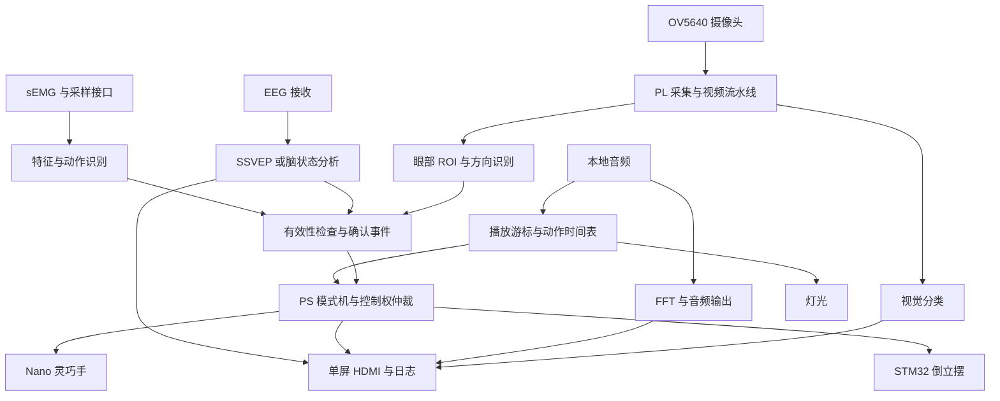

# 架构与接口草案

眼控子系统已实现；下方多模态总图保留为长期方案，其余模块没有据此宣称完成。

当前 v2 路径为屏幕上方的 P2 OV5640 → VGA RGB565/灰度 → XPM 异步 FIFO → 双眼 ROI 相对暗/亮区特征 → HDMI 自动三点校准 → 区域高亮与停留事件 → PL USB UART。每只眼单独判定，双眼一致才有效。全分辨率参与识别；偶数行列降采样成 320×240，写入预览与冻结快照两份 BRAM。全部识别与确认在 PL 内完成，PC 只做初始设置和显示，不使用 PS/DDR。

三个时钟域分别为系统 50 MHz、相机 PCLK、HDMI 25.2/126 MHz。视频通过异步 FIFO；显示控制通过保持数据加 req/ack 握手；复位异步置位、各域同步释放。新版源代码位于 `src/screen/`，共享模块继续引用 `src/eye/`；实现证据见 `report/screen/verification.md`。串口协议见 `screen_gaze.md`，与下文尚未冻结的 MCU 协议分开管理。

## 计算职责

| 层 | 计划职责 | 不应误解为 |
| --- | --- | --- |
| PL | 像素流、时钟域跨越、视频输出、ROI/特征、采样时序、按需滤波/FFT、确定时序接口 | 所有算法已在 FPGA 上完成 |
| PS/Linux/PYNQ | 模式机、参数、算法参考/模型、数据有效性、路由、日志、本地界面和播放器 | 必须依赖远程 Jupyter 才能运行 |
| Nano | 手势到实际舵机动作、机构限位和通信失效行为 | 已有统一串口协议或位置反馈 |
| STM32F103 | 原有平衡闭环、限幅限速位置参考、可用回传 | Python 直接控制电机平衡环 |

眼控可先独立验证 RTL。使用 PS DDR 时仍须配置并初始化 PS/DDR；“不运行 PYNQ”不等于“不需要 PS”。集成优先一个 overlay、按 enable 切换模式；资源报告出来后再决定是否拆分，当前不采用动态部分重配置假设。

## 三类接口分别管理

软件事件：来源、会话号、序号、采样时刻、判定时刻、时钟域、valid、quality、reason、实时/模拟/回放标记。候选方向与确认提交分开，旧会话、过期或无效事件不产生新动作。

PS-PL：AXI-Lite 管配置与状态；数据流说明格式、位宽、边界和时钟。AXI4-Stream Video 的 TLAST 通常表示行末，普通 AXI DMA 包的 TLAST 表示传输结束，不能直接混用。寄存器地址由真实 Block Design 产生。

外部 MCU：先核对原协议，再做适配。旧方案的 115200/8N1、A5 5A 帧头、CRC16 和字段仅为草案，没有冻结。明确动作单位、重复帧、超时、ACK 和遥测的不同含义。

## 模式与异常

BOOT_SELFTEST → SAFE_IDLE → EYE_CONTROL / EEG_CONTROL / EMG_CONTROL / BRAIN_MONITOR / VISION_DEMO / MUSIC_SHOW。FAULT 记录原因并采取目标专属处理。

切换时先停止旧事件发布、撤销控制权、增加会话号、清理队列，再初始化新模式。音乐时间表独占执行端；脑状态默认不获得控制权。UI 不作为控制线程时钟。

摄像头遮挡、EEG 断流、肌电饱和应拒识。倒立摆的上层失联策略由本机验证，停止上层命令不等于突然撤掉平衡驱动。音频故障暂停动作时间表。具体机构状态与阈值仍待实物确认。
