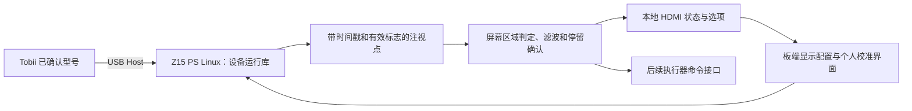

# Tobii 直接接 Z15 的眼控方案评估

2026-10-04 实板更新：原生 USB/TTP 适配已在 Z15 ARMv7 编译并取得真实
640×480 图像及约 60 Hz 眼动数据包。有效注视、个人校准和稳定识别仍未通过；
重启复测出现 USB 总线错误，换口后短测恢复。当前证据见
[实板记录](../ps_tobii/report/verification.md)，下文保留先前方案评估。

评估日期：2026-10-03。范围：取消电脑参与的脸部 ROI 传输与瞳孔回传，眼控设备直接连接 Z15；运行时和校准时都不依赖电脑。本文是方案评估，没有新增驱动、固件或实板结果。

扩大检索后的软件包、原生 USB 协议和校准核验见 [公开软件与协议检索](tobii_arm_search_20261003.md)。本轮找到 ET5 的原生开源协议实现，但没有找到已验证兼容当前 IS4 OEM 的 ARMv7 Linux 完整实现；厂家库与协议移植是两个候选方向。

## 补充照片后的型号核验

用户补充三张标签/PCB 照片，识别到组件号 `AP1QB000700 A00`、标签 `MPTK:934440681795`、日期 `2018/09/23`，支架 Dell 标签读作 `CN-0YW64G-…`。最初口头把 YW64G 读作 VW64G，已纠正。生产日期和批次标签不能直接确定固件版本。

配件商自身目录把 `AP1QB000700` 列为 Alienware 17 R4/R5 的 Tobii Eye Tracker 组件，电子模组列 XCMKD/33F74，安装支架列 YW64G。[配件目录](https://www.parts-people.com/index.php?action=item&id=23844) 这是型号对应的辅助证据，不作为针脚、电压或 ABI 的依据。

Tobii 官方明确把 Alienware 17 R4 的完整眼动集成版本与 4C 一起列入 IS4 设备。因此，高可信判断是 Alienware 17 R4/R5 使用的拆机 Tobii 眼动组件，进一步推断很可能是 17 R4 型 IS4 OEM 模组。具体 SDK 返回的设备型号、USB VID/PID 和固件仍待实际枚举，不能直接把它叫作零售 4C，也不能从这些照片确定 `IS4 Base DAW` 等更细子型号。[Tobii IS4 官方说明](https://help.tobii.com/hc/en-us/articles/4408130344337-Head-tracking-is-no-longer-working-for-those-using-Tobii-Core)

Dell 为 Alienware 17 R4 提供的 Tobii Core 驱动标注适用于 EyeChip、Windows 10 64 位。[Dell 原机驱动](https://www.dell.com/support/home/en-us/drivers/driversdetails?driverid=h1mvt) 原机还存在只有 Tobii Aware 的配置，不能将“有人在屏幕前”或 Windows Hello 功能视为输出注视点；当前组件目录和外观更符合独立眼动组件，但最终需读取设备信息。

本轮查到旧 IS4/4C 的 Linux 安装项目，作者脚本明确用 x86-64 Ubuntu、amd64 配置程序和 `lib/x64` 运行库。[作者安装脚本](https://github.com/Eitol/tobii_eye_tracker_linux_installer/blob/master/install_all.sh)

进一步只读获取该仓库的 `stream_engine_linux_3.0.4.6031.tar.gz`（3,507,664 字节），在内存中解析压缩包及 ELF 文件头，没有安装或执行其软件。包内实际库为：

| 文件 | ELF 位数 | e_machine | 架构 |
| --- | --- | --- | --- |
| `lib/x64/libtobii_stream_engine.so` | 64 | 62 | x86-64 |
| `lib/x86/libtobii_stream_engine.so` | 32 | 3 | x86 |

该包没有 ARM32 运行库。“Linux32”在这个包中是 x86 32 位，不是 Z15 的 ARM 32 位。核验源为 [仓库软件包](https://github.com/Eitol/tobii_eye_tracker_linux_installer/blob/master/stream_engine_linux_3.0.4.6031.tar.gz)。这是这一份公开历史包的实际结果，不扩大为所有历史版本或厂家定制包均不存在。

收窄后的工程判断：这块硬件具有继续做 USB 识别和运行库核验的价值；目前没有找到能直接部署到 Z15 的完整 ARMv7 Linux 软件栈，不能按可交付路线替换 r9。当前首要缺口已从“它是什么设备”变为“该 OEM 固件有没有 ARMv7 Linux 通信、注视数据和校准支持”。不建议先重写 HDL 或采购普通 USB Hub 来解决该软件缺口。

针脚、电压、设备 USB 速率尚无已核实的实物依据。本轮不提供按颜色或连接器脚数猜测的接线表，也不把未经核验的网络原理图当成这块实物的接线依据。若已有可靠 USB 转接线，下一证据是 `lsusb`、`lsusb -t` 和接入时的 `dmesg`；随后验证 SDK 枚举及有效注视样本。没有原线束对应关系时，先做连通性和电压核对。

## 结论

采用专用红外眼动仪，有机会减少现有可见光摄像头方案中的找脸、瞳孔定位和头位补偿工作。直接接 Z15 是否可行，先取决于具体设备型号、接口和 ARMv7 Linux 驱动/运行库，再取决于校准能力。当前证据不足以把照片中的设备列为可直接交付的方案。

- 如果是 EyeX：其官方要求 USB 3.0，不能通过 Z15 原生 PS USB 2.0 直接运行；普通 USB 3.0 Hub 不会把上游 USB 2.0 变成 USB 3.0。
- 如果是 4C 或具备相应能力的 IS4 模组：USB 2.0 方向值得验证，但必须拿到匹配该设备的 ARMv7 Linux 软件栈，或完整可实现的协议资料。
- 如果是消费版 Eye Tracker 5：USB 2.0 接口本身符合方向，公开产品支持主要面向 Windows；当前集成 SDK 页面明确区分 5 和 5L，不能把 5L 的开发支持套给 5。
- 如果是笔记本拆机模组：必须按实际模组料号、固件、接口和供电重新确认，不能直接套用零售 4C/5 的指标。

首张照片不足以识别型号；补充照片后的判断见上节。前述型号分支作为初次评估的通用对照保留，当前实物优先按 Alienware OEM/IS4 候选核验。

## 项目基线

维护工程为 `D:/fpga/z15_multimodal`，器件 xc7z015clg485-2。现有 r9 入口 `ps_eye_net/README.md`：OV5640 → 板端脸部 ROI → USB Wi-Fi/UDP → 电脑双眼瞳孔计算 → 摄像头坐标回传 → PS 校准、停留事件和 HDMI。当前源码及配套包存在，USB 无线真人链路仍待实测。

项目 r9 使用 ARMv7 Linux hard-float 库。保留的启动环境已核验设备树 USB0 为 host/okay，但这不代表 Tobii 驱动、供电或设备兼容性已经通过实板验证。底板实际 USB 接口和 PCB 修订仍需确认。J23 的 USB UART 是串口桥，不可当作眼动仪 USB Host。

AMD 的 Zynq-7000 手册确认 PS 是 USB 2.0 Host/Device/OTG 控制器，不能默认具备 USB 3.0 能力。[AMD UG585](https://docs.amd.com/r/en-US/ug585-zynq-7000-SoC-TRM/Introduction?contentId=WkRFOkedz2Sj7Ui80C8i1w)

## 型号与接口证据

| 设备 | 官方接口/特征 | 对直接接 Z15 的判断 |
| --- | --- | --- |
| EyeX | USB 3.0；没有 4C 的 EyeChip | 原生 USB 链路不符合要求 |
| 4C | USB 2.0 BC1.2；EyeChip；标称眼动 90 Hz | 接口有机会，软件栈仍待核验 |
| Eye Tracker 5 | USB 2.0；产品页列 Windows 10 64 位支持 | 接口通过不等于 ARM Linux 可运行 |
| 5L、4L 或其他集成型号 | 型号对应 PDK、运行时和许可 | 必须取得型号与 ARMv7 Linux 的明确支持信息 |

4C 官方对比页给出的平均功耗是 2 W，启动照明器等情形可能短时达到 5–6 W；不能仅按平均功耗判断 Z15 接口供电。带独立电源、符合设备要求的 Hub 可用于验证供电稳定性，不能解决处理器架构或 USB 版本不兼容。[4C/EyeX 官方对比](https://help.tobii.com/hc/en-us/articles/212814329-What-s-the-difference-between-Tobii-Eye-Tracker-4C-and-Tobii-EyeX)、[EyeX USB 3.0 要求](https://help.tobii.com/hc/en-us/articles/210249345-Why-does-the-EyeX-Controller-require-USB-3-0)、[Eye Tracker 5 产品页](https://gaming.tobii.com/product/eye-tracker-5/)

拆机板没有确认电压、针脚及原线束前，不把未知连接器当 USB 或 UART 接线；这是当前接口信息缺失的直接后果。

## 软件栈是当前主要缺口

用户提供的 getstarted 页面是电脑驱动入口，描述 Windows Update、Microsoft Store 和 Tobii Core/Experience 安装；它没有给出 Z15 的 Linux ARMv7 支持。[官方安装入口](https://gaming.tobii.com/getstarted/)

Tobii 当前 Streams SDK 支持表列 Windows 11 x86-64/ARMv8 64 位、Ubuntu 2022.4 x86-64（官网原文）、Android 11+ ARMv8 64 位，并要求按眼动仪型号核对能力。公开表没有列 ARMv7 Linux。该页面还明确消费版 5 与开发用 5L 的区别。这里的判断是“尚未找到公开支持证据”，不推断厂家绝对没有定制版本。[Streams SDK](https://www.tobii.com/products/integration/tobii-streams-sdk)

需要的是针对实际设备和 Z15 的完整依赖：设备通信服务（如该型号需要）、Stream Engine/平台运行库、显示配置、个人校准、配置保存恢复。检查 ELF 架构、动态加载器、hard-float ABI、glibc 和指令集要求。只有头文件、C 示例或 Python 包，不能替代底层库；x86-64 Linux 的 `.so`、ARM64 库和 Windows DLL 均不能直接在 Cortex-A9 上执行。历史 Android ARM 包也不能自动视为当前模组的 Linux 可用包。

USB 枚举成功只代表主机识别了设备。即使系统出现 `/dev/video*`，仍需确认其是否为所需红外数据以及是否存在可用眼动计算接口；不能把视频输出当作已获得注视点。没有软件栈时，协议逆向属于另一项研发任务，其时间和成功率目前不可估算。

## 软件可用之后的目标链路

运行库在 Z15 PS 上运行，PL 可承担 HDMI 显示、OSD 和后续确定时序的控制接口。Tobii 仍需要 USB 主机，主机由 Z15 的 PS Linux 担任。没有证据支持通过几根 FPGA IO 或裸机串口直接读取该模组的注视坐标。

本项目只做三区域时，坐标接收、区域判断和停留逻辑本身工作量较小；实际 CPU 占用要测量，不能将厂家在桌面 i7 上的占用率套到 Cortex-A9。若软件栈仍要求板端计算大量原始图像，需另做算力评估。

## 与 r9 的接口差异

现有 `ps_eye_net/src/app/eye_tracker.h` 的 `EyeFeature.x_q8/y_q8` 是摄像头瞳孔坐标，`normalized_x` 是眼内特征；`net_control.h` 还绑定脸框、裁剪窗口、会话与回传帧。Tobii 的屏幕注视点不能填入这些字段冒充瞳孔位置。

提出独立注视样本入口：屏幕归一化 x/y、源时间戳、接收时间、有效标志、设备状态；只有 SDK 提供时才增加质量和逐眼信息。检查非有限值、过期、离屏、断连和校准状态，再进入区域判断。左右分界加入滞回；失效时取消尚未提交的停留，恢复后重新计时。具体单位、时钟域、有效范围和超时阈值在取得实际 SDK 后冻结。

可复用现有 HDMI 框架、方向枚举以及左右停留 750 ms/回中释放 350 ms 的交互规则。需要新写屏幕坐标适配和区域判断；不直接复用基于双眼图像特征的校准代码。旧阈值作为初始产品规则，仍需真人验证。

## 脱离电脑还包含校准

Tobii 的屏幕位置配置与个人眼动校准，和项目原来的左中右眼内特征校准是不同环节。官方 PDK 页面明确包含显示配置/屏幕校准，并说明平台驱动和运行时是使用 API 的前提。[PDK 入门](https://developer.tobii.com/how-to-get-started-with-developing-software-for-the-eye-tracker-with-the-pdk/)

若只能在电脑上校准再移接设备，最多属于“配置依赖电脑、运行尝试独立”，不满足本次完整独立目标。必须验证配置存放位置、跨主机保持、设备重启后的恢复，以及 Z15 能否通过实际 SDK 发起采样、计算并应用校准。屏幕尺寸、设备相对屏幕的位置和方向也要配置。大区域的后续偏差修正可以改善选区，但不能替代缺失的设备校准。

零售外置 Tobii 的官方安装指南要求屏幕下沿安装；不能默认沿用当前 OV5640 在屏幕上方的安装。笔记本集成模组应按其自身光学安装要求处理。[外置设备安装指南](https://help.tobii.com/hc/zh-cn/articles/210252245-%E5%AE%89%E8%A3%85%E6%8C%87%E5%8D%97)

## 最小验证顺序与停止条件

| 阶段 | 需要得到的证据 | 未通过时的处理 |
| --- | --- | --- |
| 型号/接口 | 模组料号、原线束接口、电压和 USB VID/PID；确认完整计算硬件 | 先完成设备识别，不修改当前眼控主链路 |
| 软件兼容 | 针对该设备的 ARMv7 Linux 库/服务或可实现协议；ABI 与系统匹配 | 找不到时停止直接接入实现，不承诺通过编译示例解决 |
| 最小读取 | Z15 可读实时注视点、时间戳、有效标志；记录运行稳定性和供电 | 先排查驱动、通信与设备状态 |
| 独立校准 | HDMI 提示目标、板端调用校准、保存恢复并冷启动复验 | 不能只靠电脑预校准宣称完全独立 |
| 三区域 | 不连接电脑时左右中稳定选区，眨眼/离座/拔线无误提交 | 依据实测调整区域、滤波与停留规则 |
| 系统整合 | 本地 HDMI、后续控制接口和失效处理共同工作 | 保留旧包回退，集成单独验证 |

初步排查命令：在确认线束、电压和连接方式后，在 Z15 上读取 `uname -m`、`getconf LONG_BIT`、`lsusb`、`lsusb -t` 和接入前后 `dmesg`。对候选运行库读 `file`、`readelf -h`、`readelf -A`、`readelf -d`。这些是后续验证清单，本轮没有在板上执行。

若希望换购其他模组，采购条件应写成“该型号直接输出校准后注视数据，并明确支持 ARMv7 Linux，或提供可在 Z15 实现的公开协议”。只写“Linux 支持”“ARM 支持”或“USB 接口”都不够。外加 x86 小主机能避开部分兼容问题，但不符合此次直接接 Z15 的要求。

## 工程与交付影响

Tobii 成功接入后，可以取消运行时 ROI 发往电脑、电脑瞳孔计算和网络回传；摄像头可以按显示需求决定是否保留。当前文件和 SD 环境保持原样，特别是不使用 r9 的裸机备用 BOOT 覆盖已能运行的 PYNQ/Linux 卡。

比赛材料应准确写明眼动估计由 Tobii 硬件/软件提供，Z15 完成嵌入式接入、校准交互、选区、拒识、控制与显示。若要体现 PL 工作，应提交实际实现、资源和延迟结果，不能把现成眼动算法算作自研 RTL。软件开发、原始注视数据存储和运行库再分发按所取得 SDK 的实际许可确认，尤其消费版 5 与集成版 5L 不混用条件。

本轮读到的依据为项目 README、状态、决策、硬件规范、r9 说明及接口源码，以及上列厂家网页。用户给出的知乎链接两次抓取失败，未获得正文，不能声称已验证其中教程或型号。没有执行板卡下载、SD 改写、固件升级或硬件接线。
