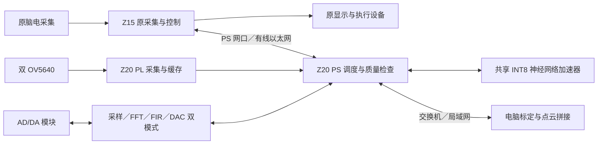

# Z15＋Z20 双板升级：需求、资料与实施计划

整理日期：2026-10-22。阶段：需求对齐与技术调研。依据为用户确认、本地工程、正点原子手册和作者维护的开源仓库。方案中的模型结构、分辨率和资源分配属于待验证设计；本次未进行训练、综合、下载或板上测试。资料由 AI 辅助检索整理，项目能力按证据范围记录。

## 1. 已经对齐的作品目标

保留原 Z15 作品，增加 Z20 作为视觉和神经网络计算节点。脑电情绪与脑电疲劳在后台持续处理；前台在人脸身份识别和双目测距／点云模式之间切换；声音分类与频谱分析按需运行。页面切换保留脑电采集、连续滤波、窗口与校准状态。

| 功能 | 本次确认的内容 | 首期输出 |
| --- | --- | --- |
| 脑电情绪 | 负向／中性／正向，三分类 | 类别、有效状态、窗口时间 |
| 脑电疲劳 | 使用脑电，沿用现有处理作为基线 | 清醒／轻度／重度的分级；阈值依据原模型与验收确定 |
| 人脸身份 | 预录入的三个人；人在固定框内配合识别 | 姓名或编号、无效／拒识状态 |
| 声音 | 三种声音，类别名称待用户补充 | 类别、有效状态、输入波形和频谱 |
| 双目测距 | 使用 ATK-MC5640D，先标定，再对选定区域测距 | 距离、视差／深度预览、无效提示 |
| 三维重建 | 首期为物体或局部场景点云，允许电脑参与 | 单帧点云，再做多视角拼接与导出 |
| AD/DA 输出 | 音频与频谱两种模式切换 | 原声音／滤波声音；逐频点幅度曲线与同步信号 |

“三个人”限定为本次登记的身份；低置信度、空框和失效输入属于状态，不强行判给三人之一。“疲劳三分类”是脑电估计结果，摄像头首期用于身份、测距与点云。移动相机扫描房间、全板端 SLAM 列为扩展。

## 2. 本地资料与已有工程能复用什么

本次对三本主手册进行了全文关键词检索，并读取、渲染核对相关章节。三本 PDF 共 3951 页；这一范围表示检索覆盖，并非逐页精读。

| 资料 | 相关 PDF 页／章节 | 用途与边界 |
| --- | --- | --- |
| [FPGA 开发指南](<D:/试卷/数字信号处理/1_【正点原子】Z20 ZYNQ之FPGA开发指南V1.0.pdf>) | 第 135 页、第 36 章第 968–976 页 | J22、FMC、AD/DA 接口、时钟、数据位宽与环回实验 |
| 同上 | 第 48 章第 1364 页起 | FFT 频谱实验，可作音频频谱通路参考 |
| 同上 | 第 49 章第 1452 页起 | FIR 实验，可作滤波与音频输出参考 |
| 同上 | 第 50 章第 1490 页起 | AD 数据经以太网发送的通路参考；使用的双路 AD 模块另有型号 |
| [Vitis 开发指南](<D:/试卷/数字信号处理/2_【正点原子】Z20 ZYNQ之嵌入式Vitis开发指南_V1.0.pdf>) | 第 38 章第 761–778 页 | 与照片同名的 ATK-MC5640D 双目采集、DDR、VDMA 和 HDMI 显示 |
| [Linux 开发指南](<D:/试卷/数字信号处理/3_【正点原子】Z20 ZYNQ之嵌入式Linux开发指南_V1.0.pdf>) | 第 221 页、7.7 节 | GE_PS 与 GE_PL 两个网口及 Linux 网络基础 |
| 同上 | 第 51 章第 1226 页起 | 板载 ES8388 音频，作为备用路线资料；首期仍按用户指定的 AD/DA 设计 |
| [Z20 底板原理图](<D:/试卷/数字信号处理/3_开发板原理图/Z20 ZYNQ开发板底板原理图_1V0.pdf>) | PDF 第 9、12、14、15 页 | J22、ES8388、摄像头 P3、FMC 的网络复用和引脚核对 |

Vitis 第 762 页正文写 J22，图注及第 776 页写 J24，存在标号不一致。本次按底板原理图的 J22 排针核对，接板前再对照实物丝印。第 38 章示范的是双画面显示：两幅 640×720 拼到 1280×720。后续标定应固定实际采集的裁剪、缩放和分辨率，不能直接套另一组图像的标定参数。

VDMA 的 Master／Slave Genlock 用来避免显示撕裂。双目标定和运动测距还需要核对两路相机的曝光时序；同帧缓存号不等于同时曝光。首期从静止物体、固定光照开始，记录两路采集帧序号与时间。

用户给出的“Z20 ZYNQ核心板”和“Z20 ZYNQ底板”目录含硬件结构／设计资料。当前 `D:/试卷/数字信号处理/4_Source_Code` 有两个子目录，递归文件数为 0。现有 PDF 可用于查接口；官方实验完整工程还需从资料盘补齐，不能把空目录当作已有源码。

### 原 Z15 工程的基线

| 本地依据 | 读取到的事实 | 本次如何使用 |
| --- | --- | --- |
| [multimodal/README.md](../multimodal/README.md)、[docs/status.md](status.md) | 已有眼控、脑电、执行端及多种模式，现场验收与候选功能分别记录 | Z15 继续拥有原控制流程，新增计算通过明确接口接入 |
| [SIGNALS.md](../integrations/vision_demo/SIGNALS.md) | 已有四页展示、真实 EEG 回放、PL 1024 点 FFT；默认回放没有本工程情绪／疲劳真值 | 复用显示、FFT 的经验；回放只验数据通路与确定性 |
| [cyton_fatigue.py](../multimodal/vendor/runtime/cyton_fatigue.py) | 250 Hz，T7/T8/O1/O2，8 秒窗口，20 项五频段 DE，HGB 回归后阈值分级 | 保留为疲劳算法基线，再训练可在 NPU 上运行的网络 |
| [cyton_covariance.py](../multimodal/vendor/runtime/cyton_covariance.py) | GAMEEMO 候选，六通道、12 秒、105 项特征、四类 RBF-SVM | 与本次情绪三类分别管理，不能直接改显示标签充当新模型 |
| [seed_quality_runtime.py](../multimodal/vendor/runtime/seed_quality_runtime.py)、[seed_shadow.py](../multimodal/vendor/runtime/seed_shadow.py) | SEED 三类线性候选，八通道、180 维，含输入重采样、质量门控和独立 shadow 输出 | 与本次负／中／正语义对应，作为情绪比较路线 |
| [seed_export_candidate.py](../multimodal/vendor/eeg_apps_z15/seed_export_candidate.py) | 导出研究候选，线性分类层仅 540 次乘加；特征计算另计 | 小分类层的 PL 加速需计入 DMA、网络和调度成本 |
| [历史 Z20 迁移方案](z20_migration_expansion_20261014.md) | 曾讨论换板迁移与资源冲突 | 保留历史；本次按新增双板重新安排 |

项目存在多套基线和候选。训练前应冻结“数据、预处理、特征、权重、运行入口、输出标签”的对应清单；不能只看文件名里有 emotion 就视为同一任务。既有 HGB、SVM、LDA 都需要与新增神经网络分开报告。

## 3. 双板分工与数据流建议

建议 Z15 负责原脑电采集、原有执行设备和总控显示；Z20 负责双目采集、共享 NPU、音频分类以及新增视觉计算。电脑用于训练、标定、点云拼接和可视化。首期先保留原采集设备的单一读取者，由 Z15 复制有时间与序号的 EEG 数据给 Z20，避免两板抢读同一个采集端。

这是建议的处理分工；AD/DA 的物理落点受接口审核约束，见第 4 节。两板及电脑一起联调时优先接千兆交换机，避免把 Z20 的 GE_PL 误当第二个现成 Linux 网口。GE_PL 需要相应 PL 以太网设计。日后可评估双板网线直连。

板间通信选择有线以太网，首期使用带长度的 TCP 二进制记录，控制与状态可使用小型结构化消息。记录至少包含协议版本、任务、序号、采集时间／窗口起止、通道或图像描述、模型版本、有效状态和负载长度。图像／点云与状态使用独立队列，限制积压；过期帧丢弃，断连清除旧结论，原 Z15 控制继续按既有失效处理运行。

EEG 只需要低带宽。按八通道、250 Hz、float32 计算，样本本体为 `8×250×4=8000 B/s`。320×240 的左右灰度图在 10 帧／秒时为 `2×320×240×10=1,536,000 B/s`，未计协议与其它流。这些是数据量估算，实际吞吐和时延要上板测量。初期优先传 EEG、分类结果和必要图像，不持续传重复显示视频。

建议先使用本地已有 Z20 Linux／Vivado 配套版本，固定内核、设备树、XSA、bitstream 与驱动的组合。PYNQ 用于原型验证时也必须重建 Z20 板级设计，不能直接使用 PYNQ-Z2 的镜像或 bitstream。

## 4. 外设接线与资源冲突

照片能确认 ATK-MC5640D V1.91 双目板、ATK-MC8008 V3.3 AD/DA 板，以及 ATK-USB_WIFI&BT。AD/DA 芯片丝印被反光和包装遮挡，尚未据照片确认实际 ADC／DAC 型号。

手册第 36 章称模块为 ATK-HS-ADDA，举例 ADC 为 3PA9280／AD9280、DAC 为 3PD9708／AD9708，均为 8 位数据；这是教程模块信息。照片上的 MC8008 V3.3 还需核对专用原理图、芯片丝印与接口方向，才能确认与该教程的电气兼容性。

| 资源 | 当前问题 | 处理方案 |
| --- | --- | --- |
| Z20 J22 2×20 | 双目和高速 AD/DA 的标准插法都使用此口，既有物理占位，也有信号复用 | 双目优先占 J22；AD/DA 另安排独立 IO |
| J22 与板载设备 | 部分网络复用摄像头 P3、ES8388、RGB LCD、CAN | 输出完整 pin／net／方向／电压／时钟表，禁用有冲突的功能 |
| FMC LPC | 可为另一外设提供独立 IO，现有照片未展示转接板 | 优先评估 FMC 转 2×20 适配；核对 Bank 电压、供电、时钟引脚与方向后再出接线表 |
| Z15 空闲 IO | 原作品已占用多类外设，不能假定还有一整组可用口 | 若 Z20 转接不可行，审核 Z15 后让 AD/DA 留在 Z15，并传音频／特征给 Z20 |
| USB WiFi／蓝牙 | 需要驱动，可能与同一 USB HUB 上设备共享带宽 | 首期只承担调试／联网辅助，板间主链路使用网线 |
| PL 与 DDR | 相机缓存、FFT、NPU、立体匹配均会竞争带宽和 BRAM | 先综合最小组合，再逐步加入；资源报表与实测决定并行度 |

不能用普通排线将两个模块直接并接 J22。FMC 转接是待准备的硬件条件，不代表目前已经拥有；若暂不增加转接，可先分别验证模块，组合演示前必须解决物理冲突。

## 5. NPU 与四个分类模型

这里的 NPU 指在 Zynq-7020 的 PL 上实现神经网络算子加速。它与原 Z15 上运行的树模型、SVM、LDA 分别保留。建议四项任务共用一个计算核心，以任务切换和权重加载支持不同网络，先完成小范围算子和可靠调度。

### 两条可实施路线

| 路线 | 合适目标 | 代价与选用条件 |
| --- | --- | --- |
| 共享 INT8 MAC／矩阵乘核心，逐步支持 Conv2D、全连接、ReLU、池化与重定标 | 一个 NPU 支持四个模型，保留相机／FFT 的资源 | 需要自己的层描述、缓冲区和调度；参考 OpenNNA、NpuKit 的已实现部分 |
| hls4ml 或 FINN 生成模型专用加速器 | 快速获得一个可比对的三分类硬件原型 | 网络／权重修改可能需要重新生成硬件；多个独立核占用累加，不能默认等于共享 NPU |

建议第一阶段以最小全连接神经网络贯通 PS→DMA→PL→PS，再决定是否扩展共享卷积。hls4ml 可作为独立结果对照或首个小模型原型；FINN 作为低比特专用网络的备选。并行展开四个专用网络前必须先核对资源。

原 EEG 分类层较小，特征计算和 8／12 秒采集窗口可能占主要时延。应同时报告核内耗时、DMA 往返、板间传输、预处理与完整结果年龄；不能仅凭 MAC 更快宣称整套脑电系统快了若干倍。

### 各任务的首版模型建议

| 任务 | 输入与预处理建议 | 神经网络候选 | 验证重点 |
| --- | --- | --- | --- |
| 情绪 | 先沿用 SEED 三类候选的八通道、180 维特征合同与因果处理 | 小 MLP，例如 180→32→16→3；属于待训练结构 | 对齐负／中／正；跨被试／跨会话划分；与原线性候选比较 |
| 疲劳 | 先复用四通道五频段 20 项 DE、校准与质量处理 | 小 MLP，例如 20→16→8→3；或回归网络后用相同阈值分级 | 对齐 HGB 的预处理与等级；用独立真值评估，新模型与教师一致率另报 |
| 三人身份 | 从一只相机固定 ROI 裁剪、缩放，候选输入 64×64 灰度 | 两至三层小 CNN＋3 类输出 | 不同日期、光照、距离测试；保留其它人和空框作为拒识测试 |
| 三种声音 | 去偏置、分帧、加窗、FFT，形成固定尺寸频谱／log-Mel | 小 CNN；若先只实现全连接，可用低维频带特征＋MLP | 声源／录制批次隔离；实物 ADC 数据与训练音频一致 |

上表尺寸用来估算设计规模，不是已训练参数。训练在电脑上进行，导出与硬件一致的量化权重、层描述、缩放因子和校验摘要。先进行浮点基线，再验证量化误差；有需要再使用 QAT。首版算子不覆盖 EEGNet 的 depthwise／separable／ELU 时，不能直接承诺运行完整 EEGNet。

SEED 数据与本次情绪标签对应，但 62 电极原始采集和本项目八通道需要准确选导联、重采样、参考与预处理匹配。SEED-VIG 使用 PERCLOS 标签，可支撑疲劳训练。数据访问按作者流程申请；同一段记录的重叠窗口必须属于同一训练／验证分组。LEMON 静息回放可用于通路检查，其现有记录缺少本工程三类真值。[SEED 官方说明](https://bcmi.sjtu.edu.cn/home/seed/)、[申请入口](https://bcmi.sjtu.edu.cn/ApplicationForm/apply_form/)。

### 固定人脸框与界面安排

建议沿用已有 1280×720 输出。人脸页左侧约 960×720 放一只摄像头画面，右侧约 320 像素显示姓名、状态和录入／识别操作。固定框先设为画面内的 240×240 正方形，最终按显示缩放和实际站位调整。裁剪坐标定义在原始采集图像，显示端只做映射，避免框与模型输入错位。

首期可在用户对齐后按键触发识别，再逐步改为稳定若干帧后更新。仅靠三分类最大概率无法保证空框拒识，需要单独采集无脸、其他人和偏离框的数据校准阈值，测试拒识覆盖率与误接收。训练集按录制会话划分，避免把相邻帧分入测试集得到虚高准确率。

双目页显示左／右图、选点框、距离和有效状态；点云页可在电脑显示，板端保留采集和距离状态。情绪与疲劳显示结果时间、输入质量和校准状态，切页仍持续处理。

## 6. 双目测距与物体／局部场景点云

建议分三步交付，先用电脑侧参考计算把几何关系验证清楚，再按资源将耗时部分迁到 Z20。

1. Z20 稳定采集左右图，固定相机基线、镜头焦距、分辨率和裁剪参数，记录相机帧与配对情况。采集多角度棋盘格图；保存内参、畸变、R/T、校正映射和 Q 矩阵。
2. 电脑使用 OpenCV 完成标定、去畸变、极线校正、BM／SGBM 与距离参考；Z20 先输出配对图像。选择有纹理的静止目标，用已知距离在多个位置验证。适合后再移植 Census／SGM 或简化匹配到 PL。
3. 由有效视差反投影点云，做深度范围裁剪、离群点清理与下采样，导出 PLY／PCD。再加入多视角配准、位姿图优化与点云融合；需要网格时另做表面重建，分别验收。

在校正后并采用相应主点约定时，可以用 `Z=fB/d` 理解深度：f 为像素焦距，B 为真实基线，d 为视差。实现按 Q 矩阵处理主点与缩放关系；原始 SGBM 定点输出也要先换成真实视差。零／负视差、遮挡和低纹理区域输出无效。ROI 内取可靠前景点的中位数，选框落在背景时不能把背景深度称为物体距离。[OpenCV calib3d](https://docs.opencv.org/4.x/d9/d0c/group__calib3d.html)。

单帧深度只能看到当前可见表面。完整物体模型需要从不同视角观察并估计位姿。首期建议物体静止、相机缓慢移动或采用已知位置的采集方式；若使用转台旋转物体，需要前景裁剪和转台运动关系，不能直接让静止背景主导 ICP 配准。反光、透明、弱纹理表面和快速运动是现场测试必须覆盖的情况。

电脑侧采用 Open3D 处理点云与配准；扩展到移动环境时再考虑 ORB-SLAM3 的位姿估计与 RTAB-Map 的建图。ORB-SLAM3 的稀疏地图不直接等于完整密集表面模型，仍需深度融合。[Open3D](https://github.com/isl-org/Open3D)、[ORB-SLAM3](https://github.com/UZ-SLAMLab/ORB_SLAM3)、[RTAB-Map stereo 输入说明](https://github.com/introlab/rtabmap_ros/blob/ros2/rtabmap_slam/doc/rtabmap.md)。

## 7. 声音、FFT 与 DAC 两种输出

声音输入链建议为“声源／线路输入→适配模拟前端→ADC→去直流与低通／降采样→环形缓冲”。麦克风是否需要偏置、放大和抗混叠滤波，依据实际模块接口确定。高速 ADC 可以在合适时钟下采样，再低通降到模型采样率；模型、FFT 频率坐标与 DAC 回放必须共用明确的采样率合同。

在声音类别确认后，先评估 16 kHz 单声道是否覆盖所需频段。频谱路径可先采用 N=1024 的 FFT：在 16 kHz 条件下频点间隔为 15.625 Hz；这是参数示例，首版数值还需看硬件与声类。分类路径可积累较长窗口形成特征图，显示频谱单独刷新。

| DAC 模式 | 数字输入 | 实际模拟输出和使用方式 |
| --- | --- | --- |
| 音频 | 原采样序列，或 FIR 等处理后的时域样本 | 按音频采样率连续输出，做重建滤波、电平和负载匹配，再接适当音频设备 |
| 频谱 | 单边幅度／功率经固定量程压缩和 DAC 量化后的数组 | 按频点顺序扫描幅度电压；单独 GPIO 给示波器外触发／扫描同步，横轴时间映射到频率 |

频谱模式每次扫描使用同一份冻结的谱，采用双缓冲避免扫描中途更新。音频模式按连续时序输出。切换时先停输出／回到规定静态值，再切缓冲与时钟，避免把一半音频和一半频谱拼在一次输出里。幅度谱已经丢失相位，要保留声音需使用独立时域支路；不能把幅度谱数组直接当作声音回放。

若最终确认是 8 位 AD/DA，输入增益、偏置和量化范围需要在现场测量；它会限制小信号细节。教程中的 ±5 V 模块输入／输出不能直接等同于耳机或话筒接口的范围。最终按实物原理图确定接口前端和连接负载。

## 8. 已核对的开源项目与资料入口

检索按“正点原子 Z20 本板、旧正点原子 7020、PYNQ-Z1／Z2、Zynq-7020 分类加速、双 OV5640 立体视觉、点云重建、EEG 三类、声音小模型”展开。名字包含 Z20 的 Zybo Z7-20、Red Pitaya Z20、ZCU 板不能视为正点原子 Z20。以下为当前找到并核对的主要入口，未发现已验证、可直接覆盖本次整套需求的 Z20 一体工程。

### NPU、量化与板级部署

| 项目／入口 | 已公开的内容 | 对本项目的适用方式与限制 |
| --- | --- | --- |
| [正点原子 Z20 官方资料](https://www.openedv.com/docs/boards/fpga/Z20.html) | 资料盘、工具盘、视频平台、讨论帖 | 补齐 Z20 实验源码与官方板级配置；资料盘提取码 n77q，工具盘 esze |
| [OpenNNA](https://github.com/xddcore/OpenNNA) | C++／HLS、SDK、本地及 TCP/IP 的 LeNet 验证，目标为旧正点原子 7020 | 同 7020 家族；README 标的是 clg400，新 Z20 为不同封装，重建 PS／引脚；通用控制器部分仍列计划 |
| [OpenNNA IP 修复说明](https://github.com/xddcore/OpenNNA/issues/1)、[源码重导出说明](https://github.com/xddcore/OpenNNA/issues/2) | 作者记录了会导致 Network 结果错误的 IP 问题 | 复现必须先核对修复版本；不能直接采用仓库旧 IP 得出准确率结论 |
| [hls4ml](https://github.com/fastmachinelearning/hls4ml)、[教程](https://github.com/fastmachinelearning/hls4ml-tutorial) | 模型到 HLS 的转换、定点配置与资源复用 | 适合小 MLP／CNN 硬件原型；按模型生成，不自动提供四模型共享调度 |
| [FINN](https://github.com/Xilinx/finn) | 量化网络到定制数据流加速器，官方推荐 Docker 编译环境 | 适合低比特专用网络；先核对算子、工具链与 Z20 板级移植成本 |
| [finn-examples](https://github.com/Xilinx/finn-examples) | bitfile、驱动、notebook 和重建入口 | 可借用软件／硬件接口；示例板的 bitfile 需针对 Z20 重建 |
| [Brevitas](https://github.com/Xilinx/brevitas) | PyTorch 的 PTQ／QAT | 用于量化训练；是训练库，与实际 FPGA 算子实现分别核对 |
| [BNN-PYNQ](https://github.com/Xilinx/BNN-PYNQ) | PYNQ-Z1／Z2 等板上的 LFC／CNV 多种低比特网络 | 历史完整链路参考；仓库已归档，依赖与样例网络较老 |
| [NpuKit](https://github.com/NetKit-Labs/npukit) | PYNQ-Z2 的 8×8 INT8 systolic GEMM、AXI DMA 与主机侧脚本 | 可参考共享矩阵乘和分块；语音演示中的 host 计算与板端算子分别审计，首期无需引入 Transformer |
| [ncnn](https://github.com/Tencent/ncnn) | 面向嵌入式 CPU 的轻量推理与模型转换 | 可评估 Zynq ARM 端 CPU 基线；它本身不为 Z20 生成 PL NPU |

版本选择有两个实际约束。AMD PG338 的修订历史在 2021-07-22 写明停止对 Zynq-7000 的支持，因此不把当前 Vitis AI DPU 流程当作 Z20 的即装方案。PYNQ 4.0 的变更记录也移除了 PYNQ-Z1／Z2 板支持；复现旧项目需要按其原版本建立环境。[AMD PG338](https://docs.amd.com/r/en-US/pg338-dpu/Revision-History)、[PYNQ 变更记录](https://github.com/Xilinx/PYNQ/blob/master/docs/source/changelog.rst)。

OpenNNA README 的一部分通用算子能力与其未勾选开发计划并列存在。本方案将已给出的 LeNet 验证、算子源码与修复入口作为依据，四模型通用能力需逐算子测试。旧工程碰到 HLS 导出问题时先检查版本及官方补丁，不直接执行网页中修改系统时间的建议。

### 双目、标定与三维重建

| 项目／入口 | 已公开的内容 | 移植重点 |
| --- | --- | --- |
| [zhutmost/stereo-vision-fpga](https://github.com/zhutmost/stereo-vision-fpga) | PYNQ-Z2＋双 OV5640，HLS 源码、Vivado Tcl、SDK；输出视差与深度显示 | 与现有相机接近，优先研究；2018.2 工具、原板 Raspberry Pi GPIO 接口须改为 Z20 接线 |
| [vishnuxd/sgm-pynq-z2](https://github.com/vishnuxd/sgm-pynq-z2) | 四路径 SGM 的 HLS、C 驱动与演示 | 作者报告 160×120、16 视差、5.9 FPS、62.5 BRAM；这是原板报告，不是 Z20＋本相机实测 |
| [zhengdt11/fpga-sgbm-stereo-vision](https://github.com/zhengdt11/fpga-sgbm-stereo-vision) | Census、代价聚合等 RTL／testbench、Vivado／Vitis 联合源码、UDP、C++ 参考 | 算法模块适合比较；完整系统需重生厂商 IP，README 明确无 bitstream 和完整 workspace |
| [OpenCV calib3d](https://docs.opencv.org/4.x/d9/d0c/group__calib3d.html) | 单／双目标定、极线校正、SGBM 与点云反投影 | 电脑上的参考实现及标定工具 |
| [Open3D](https://github.com/isl-org/Open3D) | 点云、配准、场景重建与显示 | 首期电脑端点云工具；需自行组合双目深度输入与采集位姿 |
| [ORB-SLAM3](https://github.com/UZ-SLAMLab/ORB_SLAM3) | 单目／双目／RGB-D 及视觉惯性 SLAM | 后续移动相机位姿估计参考；官方建议较强电脑，不视为 Z20 板端实时保证 |
| [RTAB-Map](https://github.com/introlab/rtabmap)、[ROS 接入说明](https://github.com/introlab/rtabmap_ros/blob/ros2/rtabmap_slam/doc/rtabmap.md) | 建图、图优化、双目等传感器输入 | 电脑端环境建图扩展；需要校正图、相机参数与正确时间配对 |

原板资源报告说明低分辨率立体匹配也可能占较多 BRAM。与 NPU 合并时先测总资源、DDR 流量和时序余量。视差范围、焦距与基线决定测距区间，不能直接套用 KITTI 数据中较大基线的误差数字。

### 脑电与声音训练

| 项目／入口 | 可以借用的内容 | 数据与部署边界 |
| --- | --- | --- |
| [ARL EEGModels／EEGNet](https://github.com/vlawhern/arl-eegmodels) | 作者实现的 EEG CNN 结构与训练示例 | 网络结构可参考；需要按本次标签、导联、250 Hz 采集链重新训练和验证算子 |
| [TorchEEG](https://github.com/torcheeg/torcheeg) | EEG 数据集、预处理、模型和实验工具 | 用于电脑侧训练和可重复比较；不是现成 Z20 bitstream |
| [SEED／SEED-VIG](https://bcmi.sjtu.edu.cn/home/seed/) | 三种情绪、以 PERCLOS 标注的警觉程度数据 | 数据访问依作者许可；疲劳连续值分三档需冻结阈值 |
| [ARM ML-KWS-for-MCU](https://github.com/ARM-software/ML-KWS-for-MCU) | 关键词分类的 DNN／CNN／DS-CNN、训练和量化示例 | 用于声音小模型参考；任意三种声音需替换数据与标签，旧 TensorFlow 环境需隔离 |

这批入口既包含完整板级案例，也包含算法、训练库和工具。使用前保存仓库 commit、许可证、原始来源和修改记录；网页可见源码不自动表示所有依赖或数据都可不受限再分发。当前首选阅读顺序：Z20 双目官方实验→双 OV5640 开源双目工程→OpenCV 标定→Open3D；NPU 则先读 OpenNNA 已实现链路与修复，再选共享核心或模型专用生成路线。

### 技能检索记录

按用户默认规则使用 Find Skills 搜索 `zynq fpga`。找到 [LNC0831/oh-my-fpga 的 zynq-bringup](https://github.com/LNC0831/oh-my-fpga/blob/main/skills/zynq-bringup/SKILL.md)，已查看内容；该技能依赖 SynthPilot／PRO 桥接环境，当前任务未具备这一环境，因此未安装或把它列为实施前提。现有 PDF、工程质量和文档技能足以支持本阶段调研。

## 9. 分阶段实施与验收

先完成可测量的单项链路，再组合。每个阶段输出可重现材料，通过相应门槛后推进；以下是实施顺序，不是未经评估的工期承诺。

| 阶段 | 工作 | 必须交付／通过的内容 |
| --- | --- | --- |
| P0 硬件与数据冻结 | 补官方源码、核对器件与引脚、确认声音标签与试验范围，记录原 Z15 工作版本 | pin/net 表、模型与数据清单、可恢复的 Z15 基线；解决 J22 冲突方案 |
| P1 基础采集和双板链路 | Z20 启动、GE_PS 通信、EEG 复制、双目采集、AD/DA 独立环回 | 序号／时间／长度正确，断连与重连可恢复，左右图和音频采样可保存对照 |
| P2 电脑侧算法基线 | SEED 情绪与疲劳比较、三人数据、三声数据、标定和 CPU 测距 | 分组的训练／验证／测试集；混淆矩阵、拒识测试、独立距离误差；保存预处理与标定 |
| P3 最小 NPU | 小 MLP 的浮点→定点参考→HLS／RTL 仿真→DMA 上板 | 饱和、负数、边界和连续请求与独立参考一致；分别记录核内和端到端耗时 |
| P4 四项三分类 | 依次接入情绪、疲劳、身份、声音；扩展必要卷积算子 | 四模型各自有指标、权重摘要、输入合同；连续任务切换后数据和权重不会串用 |
| P5 测距与点云 | 原始对采集→标定→校正→视差→距离→单帧点云 | 多距离、图像不同位置和无效区域验收；输出有单位与坐标定义的 PLY／PCD |
| P6 多视角与 DAC 双模式 | 电脑点云拼接；音频／频谱模式切换与同步 | 配准失败可识别；示波器谱峰位置正确，音频频率／幅度／连续性正确 |
| P7 联合演示 | 后台双 EEG＋前台模式＋按需声音，回归原执行端 | 切页不断采集、不重置校准；网络／NPU 失效清除结果；原 Z15 功能按基线回归 |

声音 FFT／FIR 与双目采集可以在最小 NPU 验证之外推进，但首期单项通过不代表组合 bitstream 已通过。优先做“情绪与疲劳后台连续＋一个前台功能”的组合，再加入其余模式。

### 验收记录应包含的数字

- 分类：数据来源、分组方式、各类样本量、混淆矩阵、macro-F1、balanced accuracy、拒识覆盖率与误接收；硬件量化结果与同模型参考的一致性另计。
- NPU：LUT／FF／BRAM／DSP、时序余量、权重与工作缓冲大小；核内、DMA、板间、预处理、排队和完整响应时延。
- EEG：实际采样率、丢包、质量拒绝、窗口／步进、校准时长；推理很快也不能消除采集窗口。
- 测距：基线、采集模式、有效距离区间、多个已知距离的绝对／相对误差、有效点比例与刷新率。
- 点云：导出格式、单位、坐标系、视角数、配准重叠、失败案例；点云和网格分别记录。
- AD/DA：实测采样／输出时钟、输入范围、频谱峰值频率、输出幅度与负载、扫描同步、切模式后的恢复时间。

分类准确率、最大测距误差、刷新率、目标范围和演示期限等待实际数据与用户要求确定。先测基线，再写入双方认可的验收阈值。

## 10. 接下来需要补齐的信息

目前五项结构性选择已经确认：情绪标签、疲劳输入、点云范围与电脑参与、DAC 双模式、后台／前台运行方式。下一轮集中补三种声音的名称和输入形式、MC8008 专用资料、期望测距范围与物体、准确率／刷新率和演示期限。随后冻结接口与验收，进入 P0／P1。

工程计划保存在 [Trellis 需求](../.trellis/tasks/10-22-z20-dual-board-upgrade/prd.md)、[设计草案](../.trellis/tasks/10-22-z20-dual-board-upgrade/design.md) 和 [执行计划](../.trellis/tasks/10-22-z20-dual-board-upgrade/implement.md)。本报告是本阶段面向用户的完整索引。
