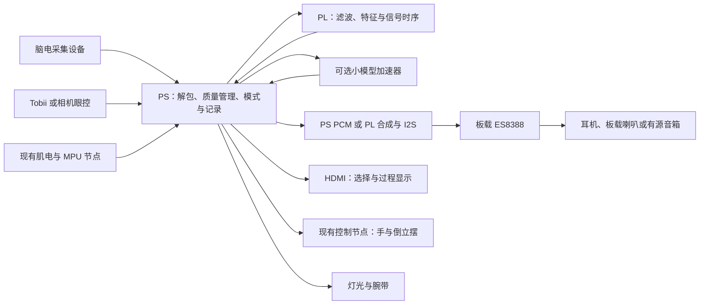

# 我们意念合一：Z20 迁移、声音交互与外设采购评估

记录日期：2026-10-14。用户计划后续将工程迁移到正点原子 Z20，并希望增加脑电驱动声音及更多外设。本文件是选型与设计评估，尚未执行迁移、购买、训练或板端部署。现有 Z15 整合任务的实现范围保持原有 PRD；新增方案分别验收。

## 1. 本轮判断

Z20 适合将现有眼控、脑控、肌电、灵巧手、倒立摆和 HDMI 展示迁移到带板载音频的新平台。采购应选择核心板与底板组成的完整开发板，板载音频、USB、相机和显示接口主要在底板上。

脑电声音第一版采用可解释的特征映射与规则合成。PYNQ 用于管理 PS/PL 和调用加速模块；NPU 用于经过训练与量化的小模型推理。这几项工作有不同的验收条件。当前提供的六份教程经全文关键词检索，未定位到独立的 NPU、DPU、FINN、BNN 或 OpenNNA 部署章节。PYNQ 指南的最后一个实验是图像缩放硬件加速，不能将其作为现成 NPU 的证据。

本轮按口述中的“pu”指 NPU 理解。具体开源 NPU 项目尚未确定；如果实际指某个另行提供的仓库，需以该仓库的算子、模型、许可证与板型支持重新评估。

优先形成能够完整演示的操作：眼睛选模式或音色，脑电改变音乐参数，肌电确认或触发节拍，声音、灯光与腕带报告结果。灵巧手增加接触反馈后，可在受控桌面工位演示抓取。倒立摆保留独立模式与 STM32 本地平衡环。

## 2. Z20 的实际资源与迁移代价

| 项目 | 资料核验 | 对本工程的作用 |
| --- | --- | --- |
| 主控 | XC7Z020CLG484-2I，双核 Cortex-A9 | 延续 ARMv7 软件思路；重新建立硬件平台 |
| PS 内存与存储 | 1GB DDR3、8GB eMMC、32MB QSPI | 帧缓存、音频缓存、模型参数与离线素材；不是新增 PL 片上 RAM |
| 音频 | ES8388、板载 MIC、PHONE、LINE_IN、板载扬声器；原理图有 MD8002A 功放 | 第一版脑电声化不依赖新增声卡、DAC 或功放板 |
| 相机 | P3 为 18 针 DVP 相机口，教程支持正点原子 OV5640/无 FIFO OV7725 | 购买匹配模块，复用采集与图像处理思路 |
| USB | 三个外接 USB2.0 HOST，板载 Wi-Fi/蓝牙占 USB HUB 的第四路 | 可接现有眼动仪、脑电接收器及其他设备；共享 USB 上行带宽 |
| 无线 | RTL8733BU Wi-Fi/蓝牙，两个 SMA 天线座 | 可以先复用板载无线；Linux/PYNQ 镜像是否包含对应驱动需上板检查 |
| 视频 | HDMI 输入、HDMI 输出、RGB LCD、LVDS LCD | 首版沿用一块 HDMI 屏；便携化后再选匹配触摸屏 |
| 控制 | UART、CAN、RS485、RS232 | 接现有执行端或后续有线设备；不同电平与协议分别适配 |
| 扩展 | J22 2×20 针，36 个用户 IO；FMC LPC | 扩展口存在复用；FMC 为将来额外 IO 或高速模块保留 |

AMD 器件资料中的 Z7015 与 Z7020 分别为 46,200/53,200 LUT、160/220 DSP、95/140 个 36Kb BRAM。增幅分别约 15.2%、37.5%、47.4%。两者均为双核 Cortex-A9。Z20 的收益主要是音频、存储、接口配套与更多 PL 资源，不能把换板解释为 CPU 成倍提速。资料来源：[AMD PL 资源表](https://docs.amd.com/r/en-US/ug585-zynq-7000-SoC-TRM/PL-Resources-by-Device-Type)、[AMD Zynq 7000 产品页](https://www.amd.com/en/products/adaptive-socs-and-fpgas/soc/zynq-7000.html)。

Z15 的 bit、hwh、XSA、FSBL 和 BOOT 不能直接用于 Z20。需重新核对器件、封装、DDR、MIO/EMIO、时钟、Bank 电压、XDC、设备树、内核与驱动。上层协议和算法可以复用，板级初始化与硬件产物必须重建。保留 Z15 可运行镜像和发布文件作为回退，Z20 先用独立 SD 卡。

## 3. 脑电如何产生声音

### 特征声化

原始脑电先经质量检查、滤波与频带特征计算，再进行个人基线归一化、平滑和限幅，最后映射到音乐参数。可选 α 频带相对功率控制滤波器明亮度，另一个特征控制音符密度；这些关系是人为设定的乐器规则，不是频带与情绪的确定对应。

使用固定音阶、限定音域和少量声部，避免特征抖动造成尖锐音调与频繁跳音。肌电事件可触发一个鼓点，眼控可选择钢琴、合成器或环境音。先播放固定音调和已知 WAV，核对声道、采样率与音量，再接入脑电。建议首版采用 48kHz 音频；脑电特征更新与逐个音频采样分开处理。

已有模型讨论中的 8 秒或 12 秒窗口适合较慢的段落、状态和曲目变化。希望声音在更短时间内变化时，应另设特征窗口和更新周期，并测量稳定性与实际延迟。脑电丢包、接触变差或数据过期时，音频参数保持有界并淡出，HDMI 报告原因。

这种形式允许听众观察屏幕中的特征、映射值和声音变化，能够用同一份脑电回放检查一致性。它属于脑电驱动的声音合成；“还原脑中旋律”“识别想说的话”需要另外的研究证据。

### 意图触发声音

已有 SSVEP 或眼控选区可以选一段音乐、确认一个音符、暂停或播放固定句子。句子可先采用预录音，复杂语音合成留在 PS 或电脑侧评估。SSVEP 的显示刺激与音乐灯光应分开：灯光不跟随刺激频率闪烁，避免改变实际视觉刺激条件。

### 状态驱动段落

当情绪或疲劳模型已有权重、相同预处理和实测证据时，可把稳定输出用于慢速切换节奏、音色或段落，并允许本人确认。状态分类结果保留置信度和未知类别，不能直接当作医疗判断或音乐干预效果。

可借鉴 [EEGsynth](https://github.com/eegsynth/eegsynth) 的脑电/肌电到声音、MIDI、灯光和其他设备的映射方式。其代码采用 GPL-3.0；借鉴思路与引入代码分别记录，代码复用时核对许可证。

## 4. PS、PL 与 NPU 分工

PS 负责 USB/网络、时间戳、状态管理、音频素材、任务调度和界面。PL 优先负责连续滤波、特征计算、稳定的视频/SSVEP 时序，以及音频 FIFO、波形合成或 I2S 数据输出。NPU 只接收定义明确的模型输入并返回分类或回归结果，不直接控制执行器。

音频实现有两条实际路径：PS 合成 PCM，经匹配 Linux 声卡驱动播放；PL 合成音频，经 I2S 输出至 ES8388。前者适合快速核对声音和算法，后者可以展示固定采样时序与 FPGA 并行实现。Linux 教程的音频实现涉及 I2S Receiver/Transmitter、Audio Formatter、Codec 驱动和设备树，PYNQ 镜像不因装有 Python 就自动获得这套通路。

所有同时运行的 PL 模块应先整合进同一个硬件设计。常规完整 overlay 下载会重配置 PL，不能把图像、NPU 和音频的三个 bit 文件依次加载后期待三者仍同时运行。部分重配置属于另外的设计，不纳入首版。

### NPU 路径比较

| 路径 | 起步工作与适用场景 | 成本与主要失效条件 |
| --- | --- | --- |
| 暂时使用 PS 推理与 PL DSP | 先完成声音及原功能迁移，测量实际 CPU 负载 | 无新增加速器硬件成本；CPU 达不到目标周期时再加速 |
| 自建小型 INT8 加速器 | 为固定 MLP 或小 CNN 做矩阵乘、卷积、激活与 AXI DMA；先与 CPU 参考逐项比较 | 需承担量化、溢出、内存布局和 DMA 调试；低计算量模型可能被传输开销抵消收益 |
| hls4ml | 从固定小模型生成 HLS 电路，比较不同复用系数与资源占用 | 算子、模型格式和工具版本需匹配；仍须集成视频/音频并完成 Z20 时序 |
| FINN/BNN 路线 | 训练量化或二值网络，生成专门的数据流加速器 | 训练和转换工具链较重；模型与量化方案需先验证，其他板型产物不能直接下载 |
| OpenNNA 路线 | 阅读算子、参考模型、发布修复和旧板工程，重新生成本板硬件 | 仓库参考的是早期 CLG400 板和旧工具版本，存在作者已披露的 IP 修复记录；不能当作新 Z20 即用工程 |
| 外接 AI 计算板或电脑 | 多模型、大模型或高分辨率检测成为明确需求时，把任务通过网络分出去 | 增加成本、供电与部署环节；展示时需说明算法实际运行位置 |

来源：[hls4ml](https://github.com/fastmachinelearning/hls4ml)、[FINN](https://github.com/Xilinx/finn)、[BNN-PYNQ](https://github.com/Xilinx/BNN-PYNQ)、[OpenNNA](https://github.com/xddcore/OpenNNA)。这些是可评估的开源路线，尚未在本工程上部署。

第一颗加速器宜绑定一个任务：脑电特征到小型状态分类器，或固定桌面中少量物体类别的图像分类。前者先要有可用训练数据与标签，后者可以先用固定 ROI、光线和摆放位置降低检测难度。现有 Haar 找脸算法、SSVEP 频谱计算不能直接视作 CNN NPU 的输入模型。FFT、滤波与相关运算可继续用 DSP 模块。

对比必须采用相同数据、预处理和模型，测量 PS 全流程与 PS+PL 全流程，包含 DMA 和缓存处理时间，并报告数值差异、准确率、LUT/DSP/BRAM、功耗与视频/音频同时运行时的结果。加速器计算核变快不等于整机端到端延迟同比下降。

## 5. 可组合的外设与演示

| 方案 | 实际操作 | 新增硬件 | 适用条件与限制 |
| --- | --- | --- | --- |
| 脑电声音乐器 | 眼控选音色；脑电调明亮度和密度；肌电触发节拍；保存一次演奏 | 先用板载音频；补耳机或有源音箱 | 有稳定原始脑电输入；先测听音和与采集同跑的噪声 |
| 发声交流 | 看句子并确认后播放；有需求再逐步增加字词组合 | 同一音频链路，无额外语音模块依赖 | 保留取消和暂停；先用已录素材验证完整交互 |
| 声音、灯光、腕带反馈 | 有效选择后腕带短振；模式变化用缓慢灯光变化；音乐参数与显示同步 | 短 RGB 灯带、DRV2605L 与匹配振子 | 灯带单独供电，避免大电流进入板卡；振动也可能污染人体信号 |
| 灵巧手接触反馈 | 预设手势接近物体，接触后限制继续闭合，界面显示接触趋势 | 两到三片 FSR、分压与采集电路、指腹软垫 | 先做受控桌面物体；FSR 需本机标定，不能把原始电阻当精确握力 |
| 眼选物体、肌电确认、手抓取 | 桌面镜头识别杯子/球等少量类别，眼控选框，确认后执行有限动作 | 固定桌面相机、支架，必要时 ToF | 现有手必须有可达机构；固定手先把物体放到固定位置，任意位置抓取另需手臂、坐标标定与反馈 |
| 距离与位置检查 | 提醒脸部是否在相机工作范围，或显示桌面目标距离 | 一个带电平适配的 VL53L1X 模块 | Tobii 已有距离输出时不重复采购同一用途；ToF 只测距离，不能恢复准确视线 |
| 便携一体机 | 单屏选模式，显示声音、输入质量和动作状态，设备固定在箱体内 | 匹配的 LVDS 触摸屏或 HDMI 小屏、外壳、固定件 | 首版沿用现有 HDMI；触摸只做工作人员设置入口，完整核对屏线与驱动 |
| 桌面设备控制 | 眼控选择低压灯或风扇、确认执行、返回状态 | 低压灯/风扇与匹配 MOSFET 驱动；需要时采用 RS485/CAN 节点 | 首版用低压负载；CAN/RS485 只有电气层，节点协议仍需定义 |
| 环境声事件提示 | 板载 MIC 获取环境音，小模型识别有限类别，屏幕与腕带提示 | 先用板载 MIC；双通道定位需要另配同步麦克风前端 | 分类依赖真实数据；一个麦克风不能提供可靠声音方向 |
| 离线关键词 | 语音选择模式或停止播放 | 先用板载 MIC，后续可选 USB 麦克风 | 继续保持候选；播放回声、噪声及识别失败需验收，物理急停独立存在 |
| 有线执行端升级 | 用 CAN/RS485 替换或补充部分无线链路，记录动作反馈 | 对端收发器、线缆与端接 | 两端修改协议并验证断连；不替代 STM32 本地平衡与保护 |
| 三维视觉/机械臂/移动底盘 | 双目深度、目标定位、抓取或移动 | 双目或深度相机、机械臂/底盘、反馈与电源 | 工作量和成本大幅增加，单独立项；新增购买不能直接补足算法与机构能力 |

FSR 的器件形式见 [Interlink FSR 402](https://www.interlinkelectronics.com/fsr-402)。腕带驱动器能力见 [TI DRV2605L](https://www.ti.com/product/DRV2605L)。ToF 需购买带稳压与电平适配的模块，具体供电决定 I2C 高电平，见 [Pololu VL53L1X 模块说明](https://www.pololu.com/product/3415)。

ADC 可先复用执行端可用输入；不足时，为慢速指尖接触采样加 ADS1115。该芯片是多路复用 ADC，最高 860SPS 是转换速率上限，不能解释为四通道各 860SPS，也不作为原始肌电/脑电高速采样方案。[TI ADS1115](https://www.ti.com/product/ADS1115)

摄像头的朝向必须先分清。眼控/面部分析需要朝向使用者，桌面识别需要朝向物体。一只固定单目摄像头不能同时得到这两个视角。若继续使用已有 Tobii 作眼控，新增 OV5640 可专用于桌面观察；若 OV5640 同时承担面部算法，就为桌面另配 USB UVC 相机或在不同演示模式中调整位置。相机眼控与 Tobii 保留各自标定，不混用结果。

## 6. 采购清单与先后顺序

用户本轮表示缺少 OV5640，因此暂按需要补购处理；历史记录中出现过该模块，不据此认定现在仍能使用。脑电设备、Tobii、ESP32、MPU、灵巧手、STM32 和倒立摆优先复用已有设备，未要求替换这些硬件。

下列预算是选型阶段的采购预留，不是实时商家报价。主板价格、套装附件、官方模块价格和库存以实际订单为准。已有物品从清单中扣除。

### 首批：建立 Z20 和音频基线

| 物品与数量 | 购买条件/规格 | 作用 | 采购预留 |
| --- | --- | --- | --- |
| Z20 完整开发板 ×1 | 核心板+底板，核对 XC7Z020CLG484-2I 和底板版本；选匹配开发附件包 | 主平台 | 商家当前报价 |
| 正点原子 OV5640 单目 DVP 模块 ×1 | 明确适配 Z20 P3，18 针排针版；核对镜头对焦与相机线长度 | 相机验证与桌面/面部候选 | 官方当前报价 |
| 正规 MicroSD ×2，读卡器 ×1 | 首版 32GB 起，容量以厂家镜像要求为准；一张开发、一张恢复 | 保留独立镜像与回退 | 合计 100～200 元预留 |
| 有线耳机 ×1 或现有耳机 | 3.5mm 立体声；先使用已有耳机 | 核对声道与合成音 | 0～100 元预留 |
| 有源音箱 ×1（可选）及音频线 | 3.5mm AUX 输入，独立供电；从 PHONE 输出接入 | 现场多人听音 | 合计 80～200 元预留 |
| 相机/眼动仪支架、夹具、固定底座 | 保证设备位置可重复，先避免手持 | 标定和录像一致性 | 50～150 元预留 |
| 匹配板电源、JTAG 下载器、USB 数据线、HDMI 线、网线 | 套装已有则不重复买；电源插头与电流按厂家套装；核对下载器支持链路 | 烧录、调试与首次启动 | 套装缺项单独询价 |

板载喇叭可以先发声，有源音箱只为改善现场听音。外接无源大喇叭不能直接取代有源音箱接 PHONE。板载 Wi-Fi/蓝牙模块存在，首批不再买 USB 网卡或蓝牙串口模块；先验证镜像驱动并核对是否随板提供天线。

### 第二批：小额硬件增加可观察反馈

| 物品与数量 | 规格与连接 | 新增能力 | 采购预留 |
| --- | --- | --- | --- |
| FSR 402 或适合指腹尺寸的薄膜压力片 ×2～3 | 模块或分压输出在执行端 ADC 范围内；配软垫、线与固定件 | 接触趋势、闭合限制实验 | 整套 80～200 元预留 |
| ADS1115 模块 ×1（有需要才买） | 采用兼容 3.3V I2C 的模块；慢速压力采样 | 执行端 ADC 不足时补充 | 20～50 元预留 |
| DRV2605L 模块+匹配 ERM/LRA 振子 ×1 | 模块供电、逻辑电平与振子额定参数配套，腕带固定 | 确认/无效输入的触觉提示 | 40～120 元预留 |
| 短 RGB 灯带或灯环 ×1 | 16～30 颗即可；配电源、数据电平转换和线 | 声音参数与操作状态可视反馈 | 整套 40～120 元预留 |
| 急停、保险、端子、供电分路与护罩 ×1 套 | 急停接现有控制器与驱动使能/安全停止链；供电额定值按舵机/电机实物选择 | 动作可中止，供电可维护 | 80～200 元预留 |
| VL53L1X 模块 ×1（用途明确才买） | 带稳压、电平转换及资料；先用于厘米级距离 | 桌面距离或相机位置提示 | 50～150 元预留 |

第二批全部按需补齐的预留合计约 310～840 元，包含可选 ADC 与 ToF，不含需要重配的大电流舵机电源。先做腕带和压力反馈两项也可，避免把扩展功能全部绑在一次交付上。

灯带、舵机与电机使用匹配的独立电源和驱动，数字信号按选定电平处理。腕带与灯光动作应在脑电/肌电采集时核对伪迹。FSR 反馈放在执行节点本地，网络只传上层目标与状态；倒立摆继续由 STM32 执行本地平衡。

### 第三批：只有明确选做功能才采购

| 物品 | 购买触发条件 | 首版暂缓的原因 |
| --- | --- | --- |
| ATK-FMC-EXTIO | 相机、音频和其他外设的统一 pinmap 证明 J22 不够或有复用冲突，且该转接卡匹配 Z20 Bank 电压 | 板上已有扩展口，小模块可先接现有 MCU；转接卡不增加 FPGA 逻辑或消除 Bank 电压限制 |
| 7/10.1 寸匹配触摸屏 | 完成 HDMI 版本后要做便携设备 | 增加屏线、触摸驱动、显示时序与供电调试 |
| USB UVC 相机 | Tobii/朝内相机之外确实还需要同时采集桌面 | 先确定视角；需验证 UVC 驱动和共享 USB 带宽 |
| 双目或深度相机 | 任务明确要求深度、坐标定位或机械臂抓取 | 相机加价之外还需要标定、同步、算法和机构 |
| USB 麦克风/同步双麦前端 | 板载 MIC 实測不足，或已决定做远场/方向任务 | 板载 MIC 足够开始采音和小范围分类验证 |
| CAN/RS485 对端模块 | 决定把一个现有执行端改为对应有线协议 | 两端固件与终端电阻/总线配置要一起做 |
| 额外多通道肌电前端 | 目标从单路确认改为可区分的多手势，已有数据表明通道不足 | 新前端需要同步、采样、标定和标签数据 |
| 电池与 BMS | 整机功耗、舵机峰值电流和运行时间已有测量 | 现阶段先做有线桌面版，避免凭平均功耗配电池 |
| 机械臂/反馈舵机/移动底盘 | 已选择任意位置抓取或移动任务 | 机构、安全停止、位置反馈与控制是新的工程范围 |
| 高速 AD/DA、USB3 FMC、四网口 FMC、外接 NPU | 实测表明现有链路不足，并有明确吞吐量或模型需求 | 脑电、慢速控制和 48kHz 音频不因接口存在就需要这些模块 |

NPU 的第一版是在 PL 中实现或生成电路，无需购买一颗“NPU 模块”。现有 AD9280/AD9708 留作独立信号实验；Z20 首版声音优先使用板载 ES8388。

## 7. 接口安排与需要避开的采购错误

P3 相机与 ES8388 可以在正确的联合设计中一起使用。J22 的部分引脚就是这些外围芯片的同一条 FPGA 网络，不可再当作空闲 IO 驱动。原理图第 9、12、14 页已经核对：相机网络覆盖 J22 的一组脚；音频 MCLK/BCLK/DAC 数据对应另一组扩展信号。加入触摸屏、CAN 或 FMC 前再做统一 pinmap。

注意 Vitis 指南第 449 页的音频示例引脚与本轮底板 1V0 原理图/总 XDC 存在差异。例如示例 MCLK 为 E19，本轮总 XDC 与底板扩展网络为 U9。这只是资料之间的不一致，当前没有新板实物版本核验；不能选一份教程里的全部约束直接移植。总 XDC 也包含不同外设的同名端口示例，不能整份加入一个联合工程。

优先沿用 HDMI，音频走板载 ES8388，低速压力、腕带和灯光接现有执行 MCU。这样可减少 Z20 扩展排针占用，并保持手、倒立摆与输入模块职责清楚。MCU 无空余 IO 时再安排新的总线或 FMC 转接。

三路外接 USB HOST 与板载无线共享 USB HUB 上行，不能算作三个独立 USB 控制器。若同时使用 Tobii、脑电接收器、无线和 UVC 相机，需测量组合吞吐、丢包、供电与驱动稳定性。固定工位可先走 PS 有线以太网进行调试，PL 千兆网口需要对应的 PL MAC 设计，不能因有插座就当作第二个现成 Linux 网口。

脑电继续用已有合格前端与原接收方式。LINE_IN、ES8388 音频 ADC、板载 XADC 和高速 AD/DA 均不能直接替代脑电电极前端。声音、振动、肌肉活动与眼动会改变记录信号，需要在实验中区分输入特征变化与动作伪迹。

## 8. 组合与验收顺序

1. 保留 Z15 版本，在独立卡上建立 Z20 Linux/PYNQ 基线。确认 DDR、串口、HDMI、USB、网络和板载音频。先用耳机听固定左右声道和 WAV；再检查 MIC 录音及音频回环。
2. 迁移已有眼控/脑控接收、肌电/MPU 与执行端协议。保持单模式、取消、超时和去重行为；重新完成各输入与手/倒立摆的原验收。
3. 固定脑电数据回放接参数映射，先在 PS 合成 PCM。验证映射范围、无效数据、停止播放和连续缓存；再接真实脑电并检查音量与噪声。
4. 实现 PL 合成/I2S 或特征加速，和 PS 参考采用同一数据比较。联合 HDMI、USB 和控制运行，记录声音 underrun、视频异常、采集丢包与资源/时序。
5. 增加压力片与腕带，先校准和单独测试，再接入受控动作。试验时使用软物体，确认本地闭合限制和人工停止链实际有效。
6. 固定一个小模型，先训练和量化，再部署一颗加速器。CPU/FPGA 同输入比较通过后才将结果接入模式或提示；分类错误不直接产生机械动作。
7. 已有六项稳定后，再选择便携屏、第二视角、桌面抓取、环境声或有线总线中的一个扩展。每项单独记录新增硬件、功能边界和实测结果。

规划周期可用“声音与迁移基线”“人体输入及执行端回归”“反馈外设”“小模型加速”划分。因当前未核对新板实物、完整镜像与 NPU 仓库，暂不承诺具体完成日期。

## 9. 演示脚本

使用者坐在固定工位，选择声音页面，通过眼控选一种音色。有效脑电特征改变声音的明亮度与音符密度，屏幕显示实际采用的特征和映射参数。肌电确认触发一次节拍，腕带短振提示事件已接受；灯光缓慢随参数变化。

切换到灵巧手页面后，声音播放暂停，先停止上一执行模式。使用者选择预设手势，在桌面固定位置抓住软物体；指尖压力片报告接触趋势，达到标定阈值后本地限制继续闭合。动作完成依据反馈条件显示，不能仅因发送了指令就显示“抓取成功”。

倒立摆单独演示，沿用 STM32 本地控制，眼控/脑控只给有限的上层动作。最后在技术页面展示 PS 与 PS+PL 的同输入比较及实测记录。摄像头识物与关键词功能只有各自验收后加入演示。

## 10. 资料位置与本轮核验

所有页码均为 PDF 从 1 开始的物理页码。

| 本地资料 | 已用内容 |
| --- | --- |
| [FPGA 开发指南](<D:/试卷/数字信号处理/2_文档教程/1_【正点原子】Z20 ZYNQ之FPGA开发指南V1.0.pdf>) | 第 70～82 页资源；89～95 页摄像头/模块；117 页无线；133～135 页音频与复用 |
| [Vitis 开发指南](<D:/试卷/数字信号处理/2_文档教程/2_【正点原子】Z20 ZYNQ之嵌入式Vitis开发指南_V1.0.pdf>) | 第 426～456 页音频环回；449 页示例约束差异 |
| [Linux 开发指南](<D:/试卷/数字信号处理/2_文档教程/3_【正点原子】Z20 ZYNQ之嵌入式Linux开发指南_V1.0.pdf>) | 第 1225 页起音频驱动；1248～1249 页 Codec 与设备树；1261～1262 页播放；1409 页起无线 |
| [PYNQ 开发指南](<D:/试卷/数字信号处理/2_文档教程/6_【正点原子】Z20 ZYNQ之PYNQ开发指南_V1.0 .pdf>) | 第 9 页 PYNQ 定义；13～14 页 overlay；86～91 页 DMA；92～109 页图像缩放 |
| [底板 1V0 原理图](<D:/试卷/数字信号处理/3_开发板原理图/Z20 ZYNQ开发板底板原理图_1V0.pdf>) | 第 6～7 页 USB HUB/无线；9 页 J22；12 页 ES8388/MD8002A；14 页 P3；15 页 FMC |
| [核心板 1V0 原理图](<D:/试卷/数字信号处理/3_开发板原理图/Z20 ZYNQ开发板核心板原理图_1V0.pdf>) | DDR/存储和核心板连接来源核对 |
| [总 XDC](<D:/试卷/数字信号处理/3_开发板原理图/Z20 ZYNQ_IO.xdc>) | 相机网络及音频 MCLK 等约束与原理图对照 |
| [现有状态](status.md)、[决策](decisions.md) | 保留 Tobii 实板、音频听音待验收与原音频候选事实 |

本轮使用 PDF 解析对六份手册共 4,848 页及两份原理图共 27 页进行全文关键词检索，重点阅读上述相关页。底板第 9、12、14 页已渲染并放大核对。源码目录中仅发现两个空的分类目录，未获得配套音频、Linux/PYNQ 镜像或 NPU 项目源代码；实施前需补齐厂家完整资料盘并核对版本。

同时检索了 FPGA 技能，查阅 Mindrally FPGA 技能内容与仓库来源。其通用规则不提供 Z20 板级资源或采购证据，本轮复用已有工程技能，未安装新技能。

本文件由本地原始资料、现有工程记录与所列开源/厂商页面辅助整理。方案与采购预算属于工程评估；没有新增板端性能、声音效果、抓取精度或整机验收结果。
