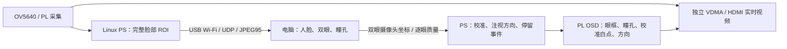

# Z15 无线眼控 r9

本版按 USB 无线网卡运行：板端 OV5640 采集 1280×720，裁剪完整脸部 ROI，通过 Wi-Fi 发给电脑；电脑定位双眼和瞳孔，将原始摄像头坐标回传。板端完成三点校准、左中右判断、停留确认和 HDMI 显示。工程在 `ps_eye_net/`，原来的 `ps_eye_auto/` r8 文件保持原样。



## 先保留已经能连无线网的 SD 卡

使用你提供的 PYNQ/Linux 启动环境及原有 USB 无线网卡驱动、Wi-Fi 配置。`linux/boot_reference/` 保存了原样的 `BOOT.BIN`、`image.ub`、`boot.scr`、`boot.py`、`REVISION`，用于比对和恢复参考。已验证 `image.ub` 的 USB0 为 host/okay、内存为 1 GB，内核/FDT 哈希和 boot.scr CRC 正确。

这些启动文件没有 Linux 根文件系统。不要格式化现有 SD 卡，也不要将 `build/BOOT.BIN` 复制到无线版启动分区：该文件是单独编译的有线裸机备用程序，会替换 Linux。无线主程序运行时加载 `linux/overlay/eye_wifi.bit` 和同名 `.hwh`，Linux 的 USB/Wi-Fi 继续由原有启动环境管理。

OV5640 接原来的 P2，HDMI 接原来的显示器，沿用已经出图的接线。停止其他使用 PL、摄像头、VDMA 或 HDMI 的程序；本版加载眼控 overlay，会替换当前 PL 设计。

## 板端运行

将完整包里的 `ps_eye_net` 文件夹复制到现有 Linux 文件系统，例如当前用户主目录。连接已有无线网络，使电脑和板卡处于可互通的局域网。在板端终端执行：

```sh
cd ~/ps_eye_net
sudo python3 linux/check_environment.py --probe-cma --report board_environment.json
sudo sh linux/start_board.sh
```

存在多个无线接口时指定实际名称：

```sh
sudo sh linux/start_board.sh --interface wlan0
```

检查会列出实际内核、Python、PYNQ、无线网卡驱动、无线 IPv4、USB host、库版本、寄存器占用和五块连续图像内存。它不会下载 bitstream 或修改 Wi-Fi 配置。通过检查后，启动程序加载 overlay、初始化摄像头和独立采集/显示通道；正常日志包含：

```text
Z15_EYE_WIFI_READY interface=wlan0 ip=<实际无线IP> port=5001 codec=JPEG95
```

记下这个 IP。`numpy`、`cv2`、`pynq` 必须在执行服务的同一个 `python3` 中可用；优先使用现有 PYNQ 环境。缺少 numpy/OpenCV 时可在该环境安装 `tools/requirements.txt`，不要在 ARM 板上安装 Windows DLL。PYNQ 缺失、ARM 库 ABI 不兼容、CMA 分配失败或摄像头启动错误时，先依据检查和终端日志修复环境。

用 Ctrl+C 停止服务。程序先复位并确认三个 DMA 通道停止，再释放 CMA；SIGTERM 也走此退出流程。`linux/z15-eye-wifi.service.example` 是可选服务模板，先改为实际目录、Python 路径和无线接口，再手动安装和启动。没有默认启用开机启动或故障重启。

## 电脑端运行

Windows 电脑使用64位 Python，安装依赖，解压完整包或单独电脑包，在 `ps_eye_net` 内执行一次：

```powershell
python -m pip install -r tools/requirements.txt
```

双击 `start_pc_net.bat`，输入板端日志中的无线 IP。也可运行：

```powershell
python tools/net_monitor.py --board 192.168.1.123
```

这里的 `192.168.1.123` 是格式示例，用实际地址替换。界面显示的图像来自板端相机；默认端口双方均为 UDP 5001。端口冲突时可用 `--local-port 5002`，板端会使用握手来源端口回传。允许电脑程序访问当前私有网络；若没有收到图像，检查双方 IPv4、无线客户端隔离和防火墙 UDP 端口。

电脑检测器是已编译的 `pc_runtime/pupil.dll`。启动时校验 DLL、模型和 C 源码哈希；DLL 和源码混用会拒绝启动。JPEG 先检查编码尺寸，再解码，避免数据包中的异常尺寸触发大内存分配。

## 校准和眼控

人脸和双眼稳定后，点击“开始三点校准”。看 **HDMI 屏幕上的白点**：依次左、中、右；每点等待 2 秒稳定时间，再逐眼累计 16 个有效样本。短暂眨眼或失去眼睛会暂停采样并保留进度。失败时界面显示错误码和重试点，点击“重试失败点”继续采集该点；“清除校准”取消整轮。

校准完成后，左右注视停留至少 750 ms 确认一次事件。持续盯住同一侧不会重复触发；看中间并停留至少 350 ms 后才重新允许侧向确认。滤波和方向切换还需要有效连续样本，所以总响应时间会比停留门槛略长。镜像导致的左右特征倒序由个人校准自动处理。

电脑回传的是双眼瞳孔的摄像头坐标，含 1/256 像素精度和逐眼质量。板端依据校准时的人脸变换投影分析眼区，再计算眼内位置；不会直接用随虹膜移动的检测框抵消眼动。界面中的“左眼/右眼”指图像左侧/右侧。

脸仍完整落在裁剪窗口内、距非画面边缘有余量时，保持窗口位置；接近边缘、丢脸或旧检测过期时更新窗口。每帧仍采集新像素，避免反复重裁剪使检测框漂移、干扰校准。

连接正常时来源显示 `PC`。回传超过 220 ms、会话/帧号不匹配、越界坐标或双眼无效均不能触发动作。连续三次无有效回传时切换 PS 本地检测，2 秒后用独立样本探测电脑，收到合格回传才切换来源；探测失败保留本地校准；电脑握手消失 1.5 秒也进入本地模式。来源切换和重新连接会清除校准，必须重新校准。板端本地检测仍受 250 ms 运行间隔限制；没有放宽门槛来掩盖 ARM 算力或无线延迟。

事件以 `EYE_EVENT seq=... direction=... source=...` 输出到板端日志，并通过状态包更新电脑界面。本版完成的是三区域眼控链路，没有新增连续桌面鼠标坐标或实际灵巧手驱动；执行器和脑电的接入仍按总工程的后续模块处理。

## 数据与源码

| 路径 | 内容 |
| --- | --- |
| `linux/board_service.py` | USB Wi-Fi UDP 服务，握手、重传、超时、回退 |
| `linux/video.py`、`linux/hardware_linux.c` | PYNQ overlay、CMA、MMIO、相机和 VDMA |
| `linux/runtime/libeye_board.so` | 已交叉编译的 ARMv7 Linux hard-float 板端核心 |
| `linux/overlay/eye_wifi.bit`、`.hwh` | 配套视频/OSD 硬件 |
| `tools/net_monitor.py` | 电脑预览和校准界面 |
| `tools/pc_receiver.py`、`tools/pc_net_bridge.c` | 组帧、双眼瞳孔计算、坐标回传 |
| `src/app/net_protocol.*`、`net_control.*` | 与 Linux/裸机/Host 共用的协议和眼控状态机 |
| `src/app/eye_tracker.*`、`auto_face.*` | r8 派生的识别、校准和停留逻辑 |
| `report/verification.md` | 本机测试结果与实板验收清单 |
| `report/package_manifest.json` | 交付文件 SHA256 |
| `WIRED_SPARE.md` | 单独的有线裸机备用方案 |

重建电脑 DLL 和 Linux 库：

```powershell
python tools/build_pc_runtime.py
python linux/build_runtime.py
```

本机完整验证：

```powershell
powershell -File tests/run_all.ps1
python tools/verify_release.py
python build/package_release.py
python tests/check_packages.py
```

硬件重建用 `build/build_hardware.ps1`，Vitis/Vivado 2023.1；裸机备用构建用 `build/build_all.ps1`。更改硬件后需重新导出配套 overlay bit/hwh、生成 BSP 和 Linux 驱动配置，不能只替换单个 bit。具体硬件契约由 `tools/verify_release.py` 校验。

已完成软件/RTL 回归、ARM 库和裸机固件编译、硬件实现与载荷配套核验。**还没有在连接无线网卡的 Z15 上实测这版**；实际网卡型号、驱动、帧率、真人瞳孔效果和无线延迟不能由本机测试代替。按 `report/verification.md` 保留首次运行日志。
